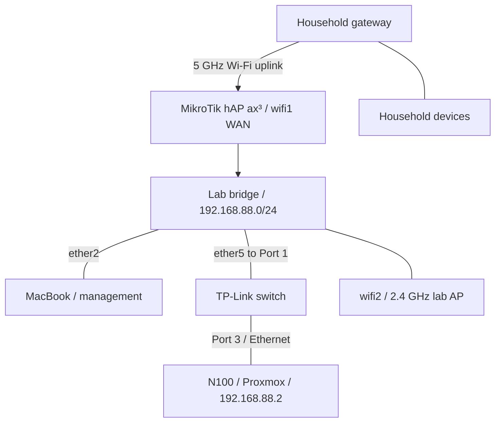

# HomeLab — Networking and Virtualization

I'm building a home lab to turn my CompTIA Network+ studies into practical experience with networking, Linux, virtualization, and security. This repository documents the build from hardware preparation and MikroTik configuration through Proxmox installation, switch integration, and initial host administration.

The focus is on the decisions, troubleshooting, and results: what I changed, why I changed it, what I verified, and what still needs work.

**Latest documented milestone:** The switch is connected, Proxmox browser access is verified through Safari, update repositories are corrected, and the N100 host has been upgraded and rebooted. Node and storage checks are complete. Cable organization and the first VM are next; the Chrome access issue remains unresolved.

*Latest documented work: October 7, 2026. README updated October 8, 2026. The phase documents are chronological records; earlier plans and pending tasks should be read alongside later outcomes.*

## Project documentation

| Phase | What it covers | Outcome at the end of that phase |
| --- | --- | --- |
| [01 — Planning, Hardware, and Preparation](docs/01-planning-and-hardware.md) | Equipment, installation prerequisites, workspace constraints, the unknown Windows software baseline, and initial household-network checks | Core equipment received; dedicated router and clean server installation selected |
| [02 — MikroTik Wireless WAN and Lab Network Setup](docs/02-network-setup.md) | Station-mode uplink, bridge membership, DHCP, WAN interface lists, NAT, and USB preparation | Internet browsing verified from the wired MacBook; Proxmox USB prepared |
| [03 — Proxmox VE Installation](docs/03-proxmox-installation.md) | USB boot, disk selection, management NIC and static IP, hostname discrepancy, first local login, and shutdown | Proxmox installed and booted; local root login succeeded |
| [04 — Switch Integration and Proxmox Operations](docs/04-switch-and-proxmox-operations.md) | Confirmed cabling, layered connectivity tests, Safari access, repository authorization failures, updates, reboot, and storage checks | Switch path and browser login verified; host updated; cable organization and first VM still pending |

## Lab hardware

| Component | Role and recorded details |
| --- | --- |
| PELADN WI-6 mini PC | Proxmox host: Intel N100, 4 cores, 8 GB RAM, 256 GB SSD |
| MikroTik hAP ax³ | Lab router, US version; 5 GHz Wi-Fi uplink and a separate lab LAN |
| TP-Link switch | Wired lab connectivity; Port 1 uplink to the router, Port 3 to Proxmox; exact model verification pending |
| MacBook with UGREEN USB-C hub | Router setup, USB preparation, connectivity testing, and Proxmox browser administration through Safari |
| SanDisk USB drive | Proxmox installation media, written using Raspberry Pi Imager |
| Monitor and keyboard | Local installation and console access |

Phase 1 recorded the switch as **TL-SG3210**, but the exact physical model was not reverified in Phase 4. Switch connectivity is confirmed; switch management and VLAN capabilities have not been tested. The latest expansion plan places services on a future Raspberry Pi and client/experiment VMs on Proxmox. The Pi was not present or configured during the documented work.

## Network layout

The MikroTik joins the household network through its 5 GHz radio, `wifi1`, in **station** mode. Its lab LAN uses `192.168.88.0/24`. In Phase 4, the N100's Ethernet path was moved through the switch; the MacBook remained connected to the router's `ether2` for management.

| Physical connection | Confirmed mapping |
| --- | --- |
| Router → switch | MikroTik `ether5` → Switch Port `1` |
| Switch → server | Switch Port `3` → N100 Ethernet |
| Management computer → router | MacBook Ethernet adapter → MikroTik `ether2` |

| Setting | Latest documented value |
| --- | --- |
| MikroTik LAN address / gateway | `192.168.88.1` |
| Lab DHCP pool | `192.168.88.10`–`192.168.88.254` |
| Proxmox static address | `192.168.88.2/24` |
| Proxmox configured gateway / DNS | `192.168.88.1` |
| Proxmox management interface | `nic0`, Ethernet driver `r8169` |
| Proxmox management URL | `https://192.168.88.2:8006` — login verified through Safari |
| Router LAN bridge members | `ether2`–`ether5`, `wifi2` |
| Router WAN interface-list members | `ether1`, `wifi1`; `ether1` unused during setup |

The separate subnet and working NAT are documented. They do **not** establish that lab-to-household access is blocked: an explicit isolation test and review of firewall rules, including IPv6 behavior if used, remain open.

## Troubleshooting highlights

| Problem | Change made | Observed result |
| --- | --- | --- |
| DHCP client could not run on `wifi1` because it remained a bridge member | Removed only `wifi1` from the LAN bridge | Upstream DHCP lease obtained |
| Router had an upstream address, but the wired client could not browse | Added `wifi1` to the WAN list used by the existing masquerade rule | Browsing succeeded from the MacBook on `ether2` |
| balenaEtcher could not open the ISO | Switched to Raspberry Pi Imager / Use Custom | Installation USB written successfully |
| Startup key attempts did not reach the USB boot menu | Used Windows Shift + Restart and selected UEFI USB PARTITION 2 | Proxmox installer started |
| Installer addressing did not match the lab network | Set `192.168.88.2/24`, outside the DHCP pool | Installed system displayed the expected management URL |
| Chrome reported `ERR_ADDRESS_UNREACHABLE` | Checked ping, TCP 8006, and HTTPS, then used Safari | Safari login succeeded; Chrome's cause remains unresolved |
| Update task failed with exit code 100 | Ran `apt update` on Proxmox; found 401 errors; disabled PVE/Ceph Enterprise and added PVE No-Subscription | Refresh returned TASK OK; later upgrade completed |
| First upgrade attempt aborted at confirmation | Retried with guidance to use the default confirmation or English `y` | Upgrade completed; subsequent reboot and new kernel were verified |

## Host snapshot after the upgrade

The following values were recorded on October 7, 2026. They describe that session, not a continuously monitored state or a recommendation to install a particular version.

| Item | Recorded value |
| --- | --- |
| Proxmox Manager | `pve-manager/9.2.21` |
| Running kernel | `Linux 7.0.14-20-pve` |
| Boot mode | EFI |
| Active repositories | Debian + Debian security + PVE No-Subscription |
| Disabled repositories | PVE Enterprise and Ceph Squid Enterprise |
| `local` | `72.73 GB` total; `6.24 GB` used |
| `local-lvm` | `151.66 GB` total; `0 B` used |
| Guests | No VM or container created yet |

The No-Subscription production-use warning remained visible. A new package-list refresh after the post-reboot inspection was not recorded; the successful upgrade is documented in Phase 4.

## Status and next work

- [x] Prepare the main hardware and installation accessories.
- [x] Configure the MikroTik wireless uplink and lab LAN.
- [x] Resolve DHCP and NAT configuration issues; verify wired-client internet access.
- [x] Prepare the Proxmox installation USB.
- [x] Replace Windows with Proxmox on the internal SSD.
- [x] Configure static management addressing and verify local root login.
- [x] Initiate an orderly shutdown using `poweroff`.
- [x] Integrate the switch and verify the physical path with ping and TCP checks.
- [x] Verify browser access from the MacBook through Safari.
- [x] Correct the update repositories, complete the upgrade, and reboot into the new kernel.
- [x] Inspect the node and the `local` / `local-lvm` storage figures.
- [ ] Organize and label cables, then recheck connectivity after moving the equipment.
- [ ] Resolve Chrome's access error; Safari remains the working browser.
- [ ] Verify the full hostname: `proxmox.lab.local` was entered, while `proxmox` was displayed.
- [ ] Verify the switch model and plan management/VLAN configuration.
- [ ] Review and test lab-to-household firewall isolation.
- [ ] Upload an ISO and create the first lightweight Ubuntu VM; final guest configuration remains undecided.
- [ ] Connect the future Raspberry Pi and choose its first service.
- [ ] Expand into additional Linux VMs, containers, and network exercises.

## Security and documentation approach

The initial seller-provided Windows installation was replaced to establish a known software baseline. Its earlier connection to household Wi-Fi was not evidence of a compromise; the basic household-device checks did not constitute a forensic investigation.

UPnP was found enabled during a later pre-installation check and was turned off. The latest recorded state is **Off**. No Proxmox port-forwarding rule was configured. WireGuard and Tailscale were discussed for possible future remote access, but neither is implemented in this record.

Passwords, household SSIDs, notification email addresses, and personal household-device inventories are omitted. Private lab IP addresses are retained to make the addressing and troubleshooting understandable. The documents distinguish completed actions, planned work, and unresolved observations.

## Skills practiced

IP addressing and DHCP · Wireless client configuration · Bridge membership · Interface lists and NAT · Switch integration and port mapping · ICMP/TCP/HTTPS troubleshooting · Bootable installation media · OS installation · Linux console access · Package repositories and host updates · Storage inspection · Technical documentation

These are hands-on learning records. Detailed configuration values describe this lab's setup and should be interpreted in the context of each phase.
