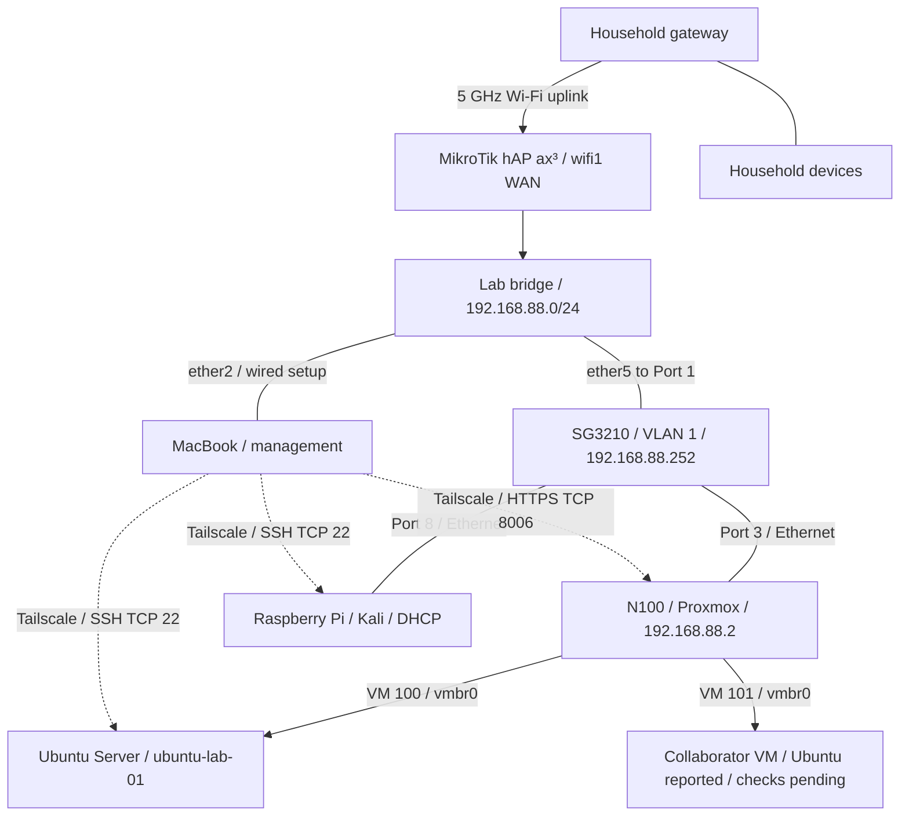

# HomeLab — Networking and Virtualization

I'm building a home lab to turn my CompTIA Network+ studies into practical experience with networking, Linux, virtualization, and security. This repository documents the build from hardware preparation and MikroTik configuration through Proxmox installation, switch integration, firewall isolation, remote Linux administration with Tailscale, and hardening the MacBook used to manage the lab.

The focus is on the decisions, troubleshooting, and results: what I changed, why I changed it, what I verified, and what still needs work.

**Latest documented milestone:** Telnet is disabled on the router and switch. Unused FTP, HTTP, and API services are also disabled on the MikroTik; a scan confirmed all five selected router ports remained closed after updating RouterOS and RouterBOOT to 7.23.8. An encrypted pre-upgrade backup was downloaded, and the existing firewall rules and interface lists were checked after reboot. I also verified NTP, corrected the Pi's time zone, reviewed effective Proxmox permissions, and granted the collaborator full sudo on the Pi. ISO-upload verification, the VM 101 storage issue, recovery tests, and remaining isolation checks are still open.

*Latest documented work and README update: October 29, 2026. This overview covers Phases 1–10. Earlier snapshots describe the end of each phase; the Phase 10 section records the latest verified changes. This is a lab record, not a live inventory.*

## Project documentation

| Phase | What it covers | Outcome at the end of that phase |
| --- | --- | --- |
| [01 — Planning, Hardware, and Preparation](docs/01-planning-and-hardware.md) | Equipment, installation prerequisites, workspace constraints, the unknown Windows software baseline, and initial household-network checks | Core equipment received; dedicated router and clean server installation selected |
| [02 — MikroTik Wireless WAN and Lab Network Setup](docs/02-network-setup.md) | Station-mode uplink, bridge membership, DHCP, WAN interface lists, NAT, and USB preparation | Internet browsing verified from the wired MacBook; Proxmox USB prepared |
| [03 — Proxmox VE Installation](docs/03-proxmox-installation.md) | USB boot, disk selection, management NIC and static IP, hostname discrepancy, first local login, and shutdown | Proxmox installed and booted; local root login succeeded |
| [04 — Switch Integration and Proxmox Operations](docs/04-switch-and-proxmox-operations.md) | Confirmed cabling, layered connectivity tests, Safari access, repository authorization failures, updates, reboot, and storage checks | Switch path and browser login verified; host updated; cable organization and first VM still pending |
| [05 — Lab Isolation and Firewall Troubleshooting](docs/05-lab-isolation-and-firewall.md) | Power reconnection, flat-LAN decisions, upstream checks, IPv4/IPv6 forwarding rules, Safe Mode rollback, and macOS route troubleshooting | Rules saved; household-gateway drop verified by counters; Tailscale and broader isolation tests pending |
| [06 — Raspberry Pi, Tailscale, and Remote Access](docs/06-raspberry-pi-and-tailscale.md) | DHCP discovery, headless SSH, Tailscale account migration, external access, policy restrictions, user accounts, Kali updates, and reboot checks | Remote SSH verified; policy saved; Pi updated; collaborator VPN access pending |
| [07 — MacBook Hardening and Switch Management](docs/07-macbook-hardening-and-switch-management.md) | MacBook firewall and permissions, switch browser access, hardware/VLAN inspection, DHCP reservation, port descriptions, Save, and configuration exports | MacBook baseline improved; switch management established and backed up; shared VLAN 1 retained |
| [08 — Shared Remote Access and the First Ubuntu VM](docs/08-shared-remote-access-and-ubuntu-vm.md) | Collaborator identity troubleshooting, remote Proxmox, separate accounts, Ubuntu installation, guest updates, and SSH-key validation | Collaborator Pi SSH and remote Proxmox verified; first VM running; key login works; key-only authentication and VM backup pending |
| [09 — VM Permissions, PHP Review, and SSH Hardening](docs/09-vm-permissions-php-review-and-ssh-hardening.md) | Scoped Proxmox pool/storage/network roles, VM 101 task review, PHP package and service checks, targeted Kali update, and Ubuntu SSH hardening | VM creation observed under collaborator account; PHP updated on Pi; Ubuntu key login works and password-only login is rejected; backups and guest/boundary checks pending |
| [10 — Network Hardening and Router Update](docs/10-network-hardening-and-router-update.md) | Effective permissions and storage checks, Pi sudo access, Nmap/tcpdump practice, NTP/time zone, management-service hardening, encrypted backup, RouterOS/RouterBOOT updates, and post-reboot checks | RouterOS and RouterBOOT at 7.23.8; five selected router ports closed after reboot; switch Telnet closed; Pi time synchronized; ISO assignment, guest storage diagnosis, and recovery tests pending |

## Lab hardware

| Component | Role and recorded details |
| --- | --- |
| PELADN WI-6 mini PC | Proxmox host: Intel N100, 4 cores, 8 GB RAM, 256 GB SSD |
| MikroTik hAP ax³ | Lab router, US version; 5 GHz Wi-Fi uplink and a separate lab LAN; RouterOS and RouterBOOT 7.23.8 verified in Phase 10 |
| TP-Link TL-SG3210 JetStream | SG3210 hardware 3.20; 8 Gigabit copper ports + 2 SFP slots; Port 1 uplink, Port 3 to Proxmox, Port 8 to Pi; management `192.168.88.252` reserved through DHCP |
| MacBook Pro with UGREEN USB-C hub | `MacBookPro16,1`, 8-core Intel Core i9, 16 GB RAM; local lab administration and Tailscale/SSH management; FileVault on and firewall enabled |
| SanDisk USB drive | Proxmox installation media, written using Raspberry Pi Imager |
| Monitor and keyboard | Local installation and console access |
| Raspberry Pi | Headless Kali Rolling 2026.2 ARM64 client; LAN address assigned by DHCP; Tailscale endpoint for remote SSH |

Phase 7 confirmed the switch as **SG3210 hardware 3.20** and inspected its existing **VLAN 1 / PVID 1** configuration. All ten listed interfaces, including the two SFP slots, were untagged members of that VLAN. Phase 6 confirmed the Pi's Kali installation and connection on **Port 8**. The Pi serves as a lab client and remotely accessible endpoint; it is not configured as a subnet router.

## Network layout

The MikroTik joins the household network through its 5 GHz radio, `wifi1`, in **station** mode. Its lab LAN uses `192.168.88.0/24`. The switch connects the N100 on Port 3 and the Pi on Port 8. The MacBook uses router `ether2` for wired setup; remote Pi access was also verified with that cable disconnected.

| Physical connection | Confirmed mapping |
| --- | --- |
| Router → switch | MikroTik `ether5` → Switch Port `1` |
| Switch → server | Switch Port `3` → N100 Ethernet |
| Management computer → router | MacBook Ethernet adapter → MikroTik `ether2` during wired setup |
| Switch → Raspberry Pi | Switch Port `8` → Pi `eth0` |

| Setting | Latest documented value |
| --- | --- |
| MikroTik LAN address / gateway | `192.168.88.1` |
| MikroTik management | SSH and Winbox retained; Telnet, FTP, HTTP, and both API services disabled; HTTPS WebFig remains disabled |
| Lab DHCP pool | `192.168.88.10`–`192.168.88.254` |
| Proxmox static address | `192.168.88.2/24` |
| Pi LAN address | DHCP; `192.168.88.250` observed in Phase 10, not a configured reservation |
| Ubuntu VM 100 LAN address | `192.168.88.249/24` observed in Phases 8–9; dynamic DHCP snapshot |
| Collaborator VM 101 address | Not established; collaborator reported Ubuntu installed, but guest identity, storage, updates, and remote access remain unverified |
| Switch management address | `192.168.88.252`; static DHCP lease on MikroTik, switch remains a DHCP client |
| Switch management URL | `https://192.168.88.252`; login verified through Chrome; certificate trust warning remains |
| Switch VLAN / PVID | VLAN 1 (`System-VLAN`), untagged ports `1/0/1`–`1/0/10`; PVID 1 throughout |
| Proxmox configured gateway / DNS | `192.168.88.1` |
| Proxmox management interface | `nic0`, Ethernet driver `r8169` |
| Proxmox management URL | `https://192.168.88.2:8006` — login verified through Safari |
| Router LAN bridge members | `ether2`–`ether5`, `wifi2` |
| Router WAN interface-list members | `ether1`, `wifi1`; `ether1` unused during setup |

Phase 5 added an IPv4 forward drop to the household subnet, a drop for new forwarded WAN connections, and an IPv6 forward drop before FastTrack6. The household-gateway client test matched **3 packets / 252 bytes**; saving the rules was confirmed. Deliberate inbound-WAN and routed-IPv6 tests remain pending. Existing general internet egress was retained; this is not an update-repository allowlist. Phase 10 verified the recorded rules and LAN/WAN memberships after the router updates, but did not repeat the household-counter or deliberate WAN/IPv6 traffic tests. The bridge and internal single-LAN design remain unchanged.

The dotted edges represent Tailscale connections, not additional physical cables. Each endpoint runs its own Tailscale client. Remote SSH was tested from a phone hotspot and from household Wi-Fi. No public port forward or advertised lab-subnet route was added. Tailscale policy controls the overlay path; it does not isolate devices sharing the lab LAN.

## Troubleshooting highlights

| Problem | Change made | Observed result |
| --- | --- | --- |
| DHCP client could not run on `wifi1` because it remained a bridge member | Removed only `wifi1` from the LAN bridge | Upstream DHCP lease obtained |
| Router had an upstream address, but the wired client could not browse | Added `wifi1` to the WAN list used by the existing masquerade rule | Browsing succeeded from the MacBook on `ether2` |
| balenaEtcher could not open the ISO | Switched to Raspberry Pi Imager / Use Custom | Installation USB written successfully |
| Startup key attempts did not reach the USB boot menu | Used Windows Shift + Restart and selected UEFI USB PARTITION 2 | Proxmox installer started |
| Installer addressing did not match the lab network | Set `192.168.88.2/24`, outside the DHCP pool | Installed system displayed the expected management URL |
| Chrome could not reach Proxmox in Phase 4 | Checked ping, TCP 8006, and HTTPS, then used Safari | Safari login succeeded; Proxmox access from Chrome was not retested in Phase 7 |
| Update task failed with exit code 100 | Ran `apt update` on Proxmox; found 401 errors; disabled PVE/Ceph Enterprise and added PVE No-Subscription | Refresh returned TASK OK; later upgrade completed |
| First upgrade attempt aborted at confirmation | Retried with guidance to use the default confirmation or English `y` | Upgrade completed; subsequent reboot and new kernel were verified |
| Cable unplugged while RouterOS was in Safe Mode | Inspected rule presence and history, then reapplied missing rules | Rollback confirmed; final changes later saved |
| Household ping timed out but the drop counter stayed at zero | Inspected macOS routes; disabled the Wi-Fi network service for the Ethernet-only test | Household drop counter increased to 3 packets / 252 bytes |
| First SSH connection to the Pi closed before a password prompt | Retried with `ssh -v` and inspected the handshake | Password login succeeded; original closure remained unexplained |
| Pi was already enrolled in a collaborator's tailnet | Logged it out over the LAN session and authenticated it into my own account | Pi and MacBook joined the same owner-controlled tailnet |
| Tailnet policy allowed unrestricted connections | Backed up the policy and limited access to the specified MacBook → Pi TCP 22 | Policy saved; a fresh SSH login succeeded |
| Collaborator account password failed during creation | Completed account creation, then set its password separately | Login and UID/group checks succeeded from my authorized MacBook |
| Post-reboot login rejected several passwords | Corrected a typing error | Remote SSH worked again; no firewall or VPN reset needed |
| Chrome could not reach the switch despite successful ping and TCP 80/443 checks | Enabled Chrome's macOS Local Network permission | HTTPS switch login became reachable; its certificate trust warning remained |
| Switch management depended on a dynamic lease | Converted the matching DHCP lease to static on MikroTik | Address remained `192.168.88.252`, status `bound`, with the entry's `D` flag removed |
| Port numbers alone made equipment identification inconvenient | Added descriptions for Ports 1, 3, and 8, then used Save and Export | Main connections labeled; updated switch backup downloaded |
| Collaborator could sign into Proxmox but could not create VMs | Added a pool and scoped pool, storage, and network roles | Create VM became available; later Tasks showed VM 101 creation under that account |
| Proxmox TCP 8006 timed out during one remote session | Access later recovered; no confirmed fix or root cause | Work resumed; the transient failure was recorded without attributing it to a specific component |
| PHP packages were installed on Kali while Apache was inactive | Simulated and applied a seven-package update | PHP CLI reported 8.4.27; Apache remained inactive |
| SSH treated the private-key file as a PKCS#11 provider | Corrected uppercase `-I` to lowercase `-i` | Key-based authentication succeeded |
| Ubuntu still accepted SSH passwords despite a working key | Added a local configuration file, checked effective settings, and reloaded SSH | Fresh key login succeeded; password-only attempt was denied |
| Collaborator reported upload and storage limitations | Read effective permissions and host storage; created an ISO-upload role | Disk permissions and free host space were already present; role assignment, upload, and guest storage diagnosis remain pending |
| Pi clock appeared wrong | Checked NTP status and changed the local zone to `America/Chicago` | Synchronization was already working; local time now displayed CDT without opening inbound UDP 123 |
| Nmap found reachable Telnet on router and switch | Disabled each device's Telnet service after establishing another management path | Both reported closed; router TCP 23 remained closed after its updates |
| Router exposed unused FTP, HTTP, and API listeners to the lab | Disabled the corresponding RouterOS services | TCP 21, 80, 8728, and 8729 reported closed, including after both reboots |
| Initial router SFTP transfer failed through the Pi | Retried with the cipher seen in a successful SSH session | Encrypted backup downloaded; original failure's cause remained unproven |
| RouterOS updated while boot firmware still showed the old version | Applied the separate RouterBOOT update and rebooted again | Active RouterOS and RouterBOOT versions both verified as 7.23.8 |

## Proxmox snapshot after the Phase 4 upgrade

The following values were recorded on October 7, 2026. They describe that session, not a continuously monitored state or a recommendation to install a particular version.

| Item | Recorded value |
| --- | --- |
| Proxmox Manager | `pve-manager/9.2.21` |
| Running kernel | `Linux 7.0.14-20-pve` |
| Boot mode | EFI |
| Active repositories | Debian + Debian security + PVE No-Subscription |
| Disabled repositories | PVE Enterprise and Ceph Squid Enterprise |
| `local` | `72.73 GB` total; `6.24 GB` used |
| `local-lvm` | `151.66 GB` total; `0 B` used |
| Guests | No VM or container created yet |

The No-Subscription production-use warning remained visible. A new package-list refresh after the post-reboot inspection was not recorded; the successful upgrade is documented in Phase 4.

## Raspberry Pi snapshot after Phase 6

Recorded on October 10, 2026:

| Item | Recorded state |
| --- | --- |
| OS / architecture | Kali Rolling 2026.2 / ARM64 |
| Running kernel after reboot | `6.12.34+rpt-rpi-2712`; unchanged from the initial check |
| Remote access | Ordinary OpenSSH over Tailscale, with Linux password authentication |
| External test | Fresh login from phone hotspot with Ethernet disconnected |
| Policy | Specified MacBook → Pi TCP 22; collaborator access not yet granted |
| Accounts | Administrator password changed; separate collaborator account created, UID/GID 1004, no `sudo` group membership shown |
| Approved upgrade plan | 1461 upgrades, 80 installs, 2 removals, 1 package not upgraded |
| Package consistency checks | `dpkg --audit` returned no findings; `apt-get check` completed without errors before reboot |
| Post-reboot checks | `ssh` and `tailscaled` active; no failed systemd units |

The account and service review was a basic security baseline, not proof that the Pi was free of malware. At the end of Phase 6, the collaborator-account test had only been performed from my MacBook. Phase 8 subsequently verified SSH from the collaborator’s own computer; Phase 10 later added that account to the Pi's `sudo` group. The exact policy structure, test results, and remaining limits are recorded in [Phase 6](docs/06-raspberry-pi-and-tailscale.md).

## MacBook and switch snapshot after Phase 7

Recorded during October 10–15, 2026:

| Area | Documented state |
| --- | --- |
| MacBook baseline | macOS `26.7.1`, build `25G241`; no DEP/MDM enrollment reported |
| MacBook protection | FileVault already on; firewall enabled; login password changed; automatic login off |
| App permissions | Chrome/Zoom microphone and reviewed camera permissions off; Zoom screen recording and background activity disabled |
| Previous owner's data | Preserved; backup confirmation required before deletion |
| Switch identity | SG3210 hardware `3.20`; System Summary firmware `3.20.0 Build 20230818 Rel.72032` |
| Switch management | HTTPS login reached; new password set; management address reserved in MikroTik DHCP |
| Network configuration | Shared VLAN 1 and PVID 1 inspected and retained; no inter-VLAN routing added |
| Port descriptions | `1/0/1`: `MikroTik-ether5`; `1/0/3`: `Proxmox-N100`; `1/0/8`: `RaspberryPi-Kali` |
| Configuration handling | Save confirmed; initial and updated switch exports downloaded |
| Remaining checks | Certificate trust, management services, time settings, firmware review, restart persistence, and restore test |

The switch export does not include its DHCP reservation, which lives on the MikroTik. Phase 10 subsequently downloaded an encrypted router backup before upgrading it; a separately recorded sanitized text export and post-upgrade backup remain open. The Chrome fix was verified against the switch; it did not constitute a new Proxmox browser test. See [Phase 7](docs/07-macbook-hardening-and-switch-management.md) for the evidence and limits.

## Remote access and Ubuntu snapshot after Phase 8

Recorded during October 15–20, 2026. The overlay addresses below are examples, consistent with earlier public documentation.

| Endpoint | Example Tailscale address | Allowed initiators / service |
| --- | --- | --- |
| Raspberry Pi | `100.101.10.10` | My MacBook and collaborator identity / TCP 22 |
| Proxmox host | `100.101.10.30` | My MacBook and collaborator identity / TCP 8006 |
| Ubuntu VM | `100.101.10.40` | My MacBook / TCP 22 |

The actual collaborator login used GitHub authentication. Correcting that identity in the policy resolved their Pi connection failure. At the end of Phase 8, the collaborator had a non-sudo Pi account; Phase 10 later granted full sudo on that device. At the end of Phase 8, a separate Proxmox account had been tested from my MacBook, while dedicated VM permissions remained open. Phase 9 records the subsequent role assignments and VM activity under that account.

| Ubuntu guest setting | Recorded value |
| --- | --- |
| ID / hostname | VM 100 / `ubuntu-lab-01` |
| OS / kernel | Ubuntu 24.04.5 LTS / `6.8.0-147-generic` |
| CPU / RAM | 2 virtual cores, CPU type `host` / 2048 MiB |
| Storage | 32 GiB SCSI disk on `local-lvm` |
| Network | VirtIO on `vmbr0`, shared lab LAN; no VLAN tag |
| Services after reboot | `ssh`, `tailscaled`, and `qemu-guest-agent` active |
| Failed systemd units | None reported |
| SSH authentication at end of Phase 8 | Fresh public-key login verified; password login still enabled then; disabled and tested in Phase 9 |
| Administration | `sudo -v` verified inside the new key-authenticated session |
| Backup / recovery | VM backup and restore test not yet completed |

Ubuntu's `.249` DHCP address was observed at a different time from the Pi's earlier `.249` address. This is not evidence of a collision, and neither observation establishes a permanent Pi address. Phase 10 later observed the Pi at `.250`. The Proxmox host remains static at `.2`.

Tailscale controls overlay connections; the guest still shares the lab LAN. During Phase 8, no additional VLAN, subnet router, public port forward, Kubernetes cluster, or collaborator VM was configured. VM 101 was created in the following phase. See [Phase 8](docs/08-shared-remote-access-and-ubuntu-vm.md) for the normalized policy, commands, and verification limits.

## Permissions and service hardening after Phase 9

Recorded during October 22–28, 2026. Account and pool names below are normalized to match the public documentation.

| Area | Result at the end of Phase 9 |
| --- | --- |
| Collaborator permissions | `lab-user@pve` received roles scoped to `collaborator-lab`, shared storage, and `vmbr0`; no global Administrator role or host root account granted |
| Actual VM work | Tasks showed VM 101 created, started, and operated under the collaborator account on October 22 |
| VM 101 at inspection | Stopped; 1 vCPU, 2 GiB RAM, 32 GiB disk; VirtIO on `vmbr0`; Ubuntu ISO attached; no Guest Agent configured |
| VM 101 guest state | Installation completion, guest identity, updates, and remote access were not verified |
| Ubuntu and Proxmox PHP review | No installed PHP packages or relevant service processes identified in the reviewed output; no PHP service observed in their TCP listener lists |
| Kali PHP update | Seven packages scheduled from `8.4.24-1` to `8.4.27-1`, no installs/removals; installation completed; CLI version 8.4.27 and inactive Apache confirmed |
| Ubuntu SSH configuration | Local `00-lab-hardening.conf` sets password authentication, keyboard-interactive authentication, and root login to `no` |
| SSH validation | Syntax check passed, effective settings matched, reload returned without error, fresh key login succeeded, password-only attempt was denied |
| Scope of SSH change | VM 100 only; Pi, Proxmox host, and VM 101 were not given the same hardening change |
| Pending updates | 530 other packages remained outside the targeted Kali plan; Ubuntu later reported nine available updates, not applied in this session |

The collaborator's pool is a resource grouping for permissions, not a network boundary or per-user resource quota. The configured assignments were:

| Path | Role |
| --- | --- |
| `/pool/collaborator-lab` | `PVEVMAdmin` and `PVEPoolUser` |
| `/storage/local-lvm` | `PVEDatastoreUser` |
| `/storage/local` | `PVEAuditor` |
| `/sdn/zones/localnetwork/vmbr0` | `PVESDNUser` |

All were assigned to `lab-user@pve` with Propagate. The broader network-zone assignment was removed after narrowing it to `vmbr0`. Phase 10 subsequently inspected the effective permission output, including the VM 101 and storage paths. Deliberate denial tests against VM 100 and other unintended resources remain open.

The Tailscale grants from Phase 8 were unchanged. A new VM has no established overlay address or remote SSH path until those are configured. The PHP checks did not inspect VM 101, comprehensively cover custom installations or containers, or establish that the systems were malware-free. A separate root SSH login attempt was not made; root was prohibited in the effective configuration.

See [Phase 9](docs/09-vm-permissions-php-review-and-ssh-hardening.md) for the recorded ACL paths, package plan, listener inventory, task history, SSH commands, and validation limits.

## Network hardening and router update after Phase 10

Recorded during October 28–29, 2026. The existing single-LAN topology and Tailscale grants were retained.

| Area | Latest verified result or remaining limit |
| --- | --- |
| Proxmox effective permissions | VM 101 disk configuration and `local-lvm` allocation permissions already present; `local` had audit access without `Datastore.AllocateTemplate` |
| Host storage | `local` and `local-lvm` active, with approximately 54.5 GiB and 132.8 GiB available; this did not resolve the guest's reported storage problem |
| ISO uploads | Custom `LabISOUploader` role created with `Datastore.Audit` and `Datastore.AllocateTemplate`; intended `/storage/local` assignment and upload test still unconfirmed |
| Pi collaborator administration | `lab-user` added to the `sudo` group; membership verified and reconnection reported; this grants full sudo on the Pi, not Proxmox root access |
| Network practice | Used `journalctl -f`, `tcpdump -D`, `tcpdump -i eth0`, and a lab-subnet Nmap scan; no saved packet capture recorded |
| Pi time | NTP active and synchronized; changed display zone from UTC to `America/Chicago`; no inbound UDP 123 rule added |
| Router management services | Telnet, FTP, HTTP WebFig, API, and API over TLS disabled; SSH and Winbox retained; HTTPS WebFig still disabled |
| Switch Telnet | Disabled through HTTPS reached by an SSH tunnel; reported closed; persistence across switch reboot not tested |
| Router account/script review | One full-access admin account, two visible default scripts, no scheduler entries; limited review, not a forensic assessment |
| Backup | Encrypted `before-update-2026-10-29.backup` downloaded through SFTP before upgrade; no restore test recorded |
| Router software | RouterOS upgraded from 7.20.8 to **7.23.8 long-term**; separate RouterBOOT update and second reboot brought active firmware to **7.23.8** |
| Post-reboot checks | Selected ports still closed; IPv4 rules, LAN/WAN lists, and the IPv6 forward drop before FastTrack6 remained present |
| DNS follow-up | Tailscale detected a `dhcpcd` overwrite of resolver configuration, restored it, and cleared the warning; no lasting DNS change applied |

The final scan was run from the Pi against the MikroTik:

| TCP port | Service | Final result |
| --- | --- | --- |
| 21 | FTP | Closed |
| 23 | Telnet | Closed |
| 80 | HTTP WebFig | Closed |
| 8728 | RouterOS API | Closed |
| 8729 | RouterOS API over TLS | Closed |

These are results for the selected ports from the tested lab path. They do not mean that all router services were disabled or that every network path was tested. Disabling HTTP WebFig removed the router's HTTP management page; it did not block outbound web browsing from lab clients. SSH through the Pi remained available, without a public port forward.

The earlier subnet scan used Nmap's default common TCP ports, not every port. `.252` was the switch, while Proxmox was `.2`. The label `squid-http` on Proxmox TCP 3128 was not an application identification: the process inventory had already shown `spiceproxy` there. No PHP compromise or other intrusion was established by these checks.

The router backup captured the hardened settings **before** the firmware update. A new post-upgrade backup, recovery testing, a fresh household-subnet traffic test, and deliberate inbound-WAN/routed-IPv6 tests remain pending. The switch was not rebooted alongside the router.

See [Phase 10](docs/10-network-hardening-and-router-update.md) for the commands, permission and storage findings, NTP readings, backup transfer, separate update steps, and verification limits.

## Status and next work

- [x] Prepare the main hardware and installation accessories.
- [x] Configure the MikroTik wireless uplink and lab LAN.
- [x] Resolve DHCP and NAT configuration issues; verify wired-client internet access.
- [x] Prepare the Proxmox installation USB.
- [x] Replace Windows with Proxmox on the internal SSD.
- [x] Configure static management addressing and verify local root login.
- [x] Initiate an orderly shutdown using `poweroff`.
- [x] Integrate the switch and verify the physical path with ping and TCP checks.
- [x] Verify browser access from the MacBook through Safari.
- [x] Correct the update repositories, complete the upgrade, and reboot into the new kernel.
- [x] Inspect the node and the `local` / `local-lvm` storage figures.
- [x] Reconnect the equipment using the temporary integrated-cord power strip arrangement.
- [ ] Complete the final cable layout and labeling; record a full connectivity recheck.
- [x] Restore Chrome access to the switch by enabling its Local Network permission.
- [ ] Retest Chrome access to Proxmox separately; the earlier Safari login remains the verified Proxmox browser path.
- [ ] Verify the full hostname: `proxmox.lab.local` was entered, while `proxmox` was displayed.
- [x] Identify the switch as SG3210 hardware 3.20 and record the displayed firmware.
- [x] Inspect and document shared VLAN 1, untagged membership, and PVID 1 without changing the design.
- [x] Set a new switch management password and verify HTTPS login.
- [x] Reserve `192.168.88.252` for the switch in MikroTik DHCP.
- [x] Describe Ports 1, 3, and 8; confirm Save and download an updated switch export.
- [x] Disable switch Telnet through its HTTPS interface and check that TCP 23 is closed.
- [ ] Confirm persistence of the latest switch service change; review time settings, firmware suitability, remaining HTTP access, and certificate trust.
- [ ] Validate switch restart persistence and backup restoration in a planned maintenance window.
- [x] Review the MikroTik policy, apply lab isolation rules, and verify the household-gateway drop counter.
- [x] Confirm that the final Safe Mode changes were saved.
- [ ] Test inbound-WAN blocking, routed IPv6 behavior, and HTTPS again with the test client using only the lab path.
- [x] Create an encrypted pre-upgrade router backup and download it to the MacBook through SFTP.
- [ ] Create and download a separately named post-upgrade router backup; preserve the earlier copy, prepare a sanitized text export, and plan a recovery test.
- [x] Disable MikroTik Telnet, FTP, HTTP, API, and API over TLS; verify the selected ports closed before and after the update.
- [x] Inspect router users, scripts, and scheduler entries.
- [ ] Review active wireless/WPS settings separately; the default WPS script alone did not establish their state.
- [x] Update RouterOS and RouterBOOT separately to 7.23.8; verify both versions after their reboots.
- [x] Recheck IPv4 rules, LAN/WAN memberships, and the routed-IPv6 drop after updating.
- [x] Transfer the Pi's existing Tailscale enrollment to my account and enroll the MacBook.
- [x] Verify remote SSH from a phone hotspot with lab Ethernet disconnected.
- [x] Save a restricted MacBook-to-Pi tailnet policy and test a fresh SSH login.
- [x] Review Pi services, listeners, accounts, and SSH authentication settings.
- [x] Change the administrator password and verify a new login.
- [x] Create and test a separate collaborator account from my authorized MacBook.
- [x] Upgrade Kali, reboot, and verify remote access and active services.
- [x] Correct collaborator identity and verify Pi SSH from their own device.
- [x] Add the collaborator to the Pi's `sudo` group and verify membership; full Pi administration is now authorized.
- [x] Verify the Pi's NTP synchronization and set its display time zone to `America/Chicago`.
- [x] Practice log inspection, interface capture, and common-TCP-port scanning on the lab.
- [ ] Follow up on resolver configuration contention if the Tailscale/`dhcpcd` warning recurs.
- [x] Create a dedicated MacBook SSH key and verify its use on Ubuntu.
- [ ] Verify key authentication on the Pi; back up its configuration and the latest tailnet policy.
- [x] Review the MacBook inventory, FileVault state, and management enrollment.
- [x] Enable the MacBook firewall and confirm that SSH to the Pi still works.
- [x] Review sharing, app permissions, background items, and browser settings; change the login password.
- [ ] Confirm the previous owner's backup before deleting personal files.
- [ ] Confirm off-device access to the FileVault recovery key; a recovery test has not been recorded.
- [x] Enable remote Proxmox HTTPS through Tailscale and verify access from a phone hotspot.
- [x] Assign scoped Proxmox pool, storage, and network roles; confirm Create VM and observe actual VM 101 operations under the collaborator account.
- [x] Read effective collaborator permissions and inspect host storage availability.
- [ ] Validate denied access to unintended resources, including VM 100.
- [x] Create the custom `LabISOUploader` role.
- [ ] Verify its assignment at `/storage/local` and test an ISO upload through the collaborator account.
- [ ] Diagnose VM 101's storage issue using the exact error, virtual-disk settings, and guest `df`/`lsblk` output before resizing anything.
- [ ] Verify VM 101 guest installation, hostname, updates, Guest Agent, and intended remote access with the collaborator.
- [x] Create VM 100, install Ubuntu Server, and verify SSH, Tailscale, and QEMU Guest Agent after updates and reboot.
- [x] Inspect Ubuntu SSH settings, disable password/keyboard-interactive authentication and direct root login, reload, and verify key login plus password-only rejection.
- [x] Review PHP packages, processes, and TCP listeners on Ubuntu, the Pi, and the Proxmox host.
- [x] Apply the targeted seven-package PHP update on Kali and confirm Apache remains inactive.
- [ ] Plan the remaining Kali and Ubuntu updates; the targeted PHP change was not a full system upgrade.
- [ ] Create a VM 100 backup on a suitable destination and verify restoration; keep secure copies of the SSH key and important configuration.
- [ ] Design isolation before adding intentionally vulnerable guests.
- [x] Verify the Raspberry Pi's OS, address, Ethernet connection, and SSH access.
- [ ] Expand into additional Linux VMs, containers, and network exercises.

## Security and documentation approach

The initial seller-provided Windows installation was replaced to establish a known software baseline. Its earlier connection to household Wi-Fi was not evidence of a compromise; the basic household-device checks did not constitute a forensic investigation.

UPnP was found enabled during a later pre-installation check and was turned off. The latest recorded state is **Off**. No public Proxmox or SSH port-forwarding rule was configured. Phase 5 added the MikroTik forwarding rules; Phase 6 established ordinary SSH over Tailscale to the Pi and narrowed the tailnet policy. Phase 7 enabled the MacBook firewall, reduced app permissions, and organized switch management. Phase 8 added collaborator access, remote Proxmox HTTPS, and a separately enrolled Ubuntu guest with tested SSH-key authentication. Phase 9 added scoped VM-management permissions, a targeted PHP update on Kali, and tested key-only SSH authentication on Ubuntu VM 100. Phase 10 disabled unused management services, downloaded an encrypted router backup, updated RouterOS and RouterBOOT, and checked the recorded firewall configuration afterward. It also granted the collaborator full sudo on the Pi; that account should no longer be described as restricted to ordinary-user operations. These controls do not automatically isolate same-LAN devices from one another or route a computer's independent household Wi-Fi connection through the lab. No lab-subnet route was advertised through Tailscale.

Passwords, authentication URLs, household SSIDs, account email addresses, MAC addresses, and personal household-device inventories are omitted. Private LAN addresses are retained to make addressing and troubleshooting understandable. Phase 6 uses clearly marked example Tailscale IPs and a normalized collaborator username; Phase 7 retains that convention and substitutes `<SWITCH_MAC>` in the DHCP template. Phase 8 extends the same convention with example Proxmox and Ubuntu overlay addresses, normalized usernames, and a placeholder collaborator identity. Phase 9 keeps those examples and normalizes the collaborator pool and Proxmox account names. Phase 10 follows the same convention, including the Pi sudo-account example, and omits router serial numbers, actual host-key fingerprints, and personal download paths. Actual identifiers remain in the private working record. Recovery keys and raw router/switch configuration backups are not included. The documents distinguish completed actions, planned work, and unresolved observations.

## Skills practiced

IP addressing and DHCP · Wireless client configuration · Bridge membership · Interface lists and NAT · Switch integration and port mapping · ICMP/TCP/HTTPS troubleshooting · Bootable installation media · OS installation · Linux console access · Package repositories and host updates · Storage inspection · Stateful firewall rules · Safe Mode recovery · macOS routing diagnosis · Firewall-counter validation · Headless Linux administration · SSH authentication inspection · Tailscale enrollment and access policy · External-access testing · Linux user management · tmux-assisted upgrades · Post-reboot validation · macOS firewall and privacy review · Browser local-network troubleshooting · VLAN/PVID inspection · DHCP reservations · Switch port descriptions · Configuration saving and backup · Proxmox authentication realms · VM provisioning · QEMU Guest Agent · SSH host-key verification · Public-key authentication · Proxmox pool and ACL scoping · Task-history review · Package/process/listener correlation · Targeted package upgrades · SSH configuration precedence · Positive and negative authentication tests · Effective-permission inspection · ISO-upload role design · Packet capture and port-scan interpretation · NTP and time-zone diagnosis · SSH local forwarding and jump hosts · Management-service hardening · Encrypted off-device router backup · RouterOS and RouterBOOT maintenance · Technical documentation

These are hands-on learning records. Detailed configuration values describe this lab's setup and should be interpreted in the context of each phase.
