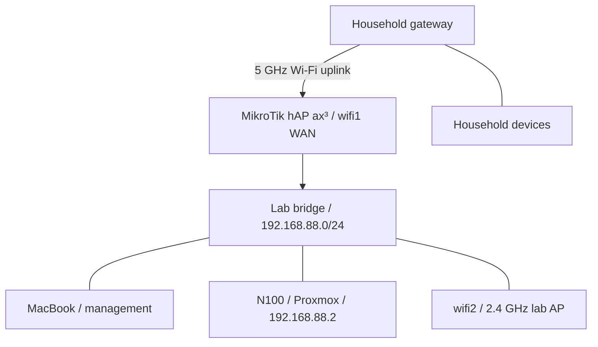

# HomeLab — Networking and Virtualization

I'm building a home lab to turn my CompTIA Network+ studies into practical experience with networking, Linux, virtualization, and security. This repository documents the build from hardware preparation through MikroTik configuration and the first Proxmox installation.

The focus is on the decisions, troubleshooting, and results: what I changed, why I changed it, what I verified, and what still needs work.

**Latest documented milestone:** Proxmox VE installed on the Intel N100 host, static management address configured, and local `root` login verified. Browser management and the first VM remain the next steps.

*Documentation snapshot: October 4, 2026. The phase documents are chronological records; earlier plans are not necessarily the final configuration.*

## Project documentation

| Phase | What it covers | Outcome at the end of that phase |
| --- | --- | --- |
| [01 — Planning, Hardware, and Preparation](docs/01-planning-and-hardware.md) | Equipment, installation prerequisites, workspace constraints, the unknown Windows software baseline, and initial household-network checks | Core equipment received; dedicated router and clean server installation selected |
| [02 — MikroTik Wireless WAN and Lab Network Setup](docs/02-network-setup.md) | Station-mode uplink, bridge membership, DHCP, WAN interface lists, NAT, and USB preparation | Internet browsing verified from the wired MacBook; Proxmox USB prepared |
| [03 — Proxmox VE Installation](docs/03-proxmox-installation.md) | USB boot, disk selection, management NIC and static IP, hostname discrepancy, first local login, and shutdown | Proxmox installed and booted; local root login succeeded |

## Lab hardware

| Component | Role and recorded details |
| --- | --- |
| PELADN WI-6 mini PC | Proxmox host: Intel N100, 4 cores, 8 GB RAM, 256 GB SSD |
| MikroTik hAP ax³ | Lab router, US version; 5 GHz Wi-Fi uplink and a separate lab LAN |
| MacBook with UGREEN USB-C hub | Router setup, USB preparation, and planned browser administration |
| SanDisk USB drive | Proxmox installation media, written using Raspberry Pi Imager |
| Monitor and keyboard | Local installation and console access |

A TP-Link switch, recorded in Phase 1 as **TL-SG3210**, and additional systems were part of expansion planning. The switch's physical model still needed verification. The documented installation used an Ethernet connection from the N100 to a MikroTik LAN port; switch deployment is not claimed as completed.

## Network layout

The MikroTik joins the household network through its 5 GHz radio, `wifi1`, in **station** mode. Its lab LAN uses `192.168.88.0/24`. The N100 is connected by Ethernet, and the MacBook is used for management.

| Setting | Latest documented value |
| --- | --- |
| MikroTik LAN address / gateway | `192.168.88.1` |
| Lab DHCP pool | `192.168.88.10`–`192.168.88.254` |
| Proxmox static address | `192.168.88.2/24` |
| Proxmox configured gateway / DNS | `192.168.88.1` |
| Proxmox management interface | `nic0`, Ethernet driver `r8169` |
| Proxmox management URL | `https://192.168.88.2:8006` — browser verification pending |
| Router LAN bridge members | `ether2`–`ether5`, `wifi2` |
| Router WAN interface-list members | `ether1`, `wifi1`; `ether1` unused during setup |

The separate subnet and working NAT are documented. They do **not** establish that lab-to-household access is blocked: an explicit isolation test and review of firewall rules, including IPv6 behavior if used, remain open.

## Troubleshooting highlights

| Problem | Change made | Observed result |
| --- | --- | --- |
| DHCP client could not run on `wifi1` because it remained a bridge member | Removed only `wifi1` from the LAN bridge | Upstream DHCP lease obtained |
| Router had an upstream address, but the wired client could not browse | Added `wifi1` to the WAN list used by the existing masquerade rule | Browsing succeeded from the MacBook on `ether2` |
| balenaEtcher could not open the ISO | Switched to Raspberry Pi Imager / Use Custom | Installation USB written successfully |
| Startup key attempts did not reach the USB boot menu | Used Windows Shift + Restart and selected UEFI USB PARTITION 2 | Proxmox installer started |
| Installer addressing did not match the lab network | Set `192.168.88.2/24`, outside the DHCP pool | Installed system displayed the expected management URL |

## Status and next work

- [x] Prepare the main hardware and installation accessories.
- [x] Configure the MikroTik wireless uplink and lab LAN.
- [x] Resolve DHCP and NAT configuration issues; verify wired-client internet access.
- [x] Prepare the Proxmox installation USB.
- [x] Replace Windows with Proxmox on the internal SSD.
- [x] Configure static management addressing and verify local root login.
- [x] Initiate an orderly shutdown using `poweroff`.
- [ ] Verify browser access from the MacBook.
- [ ] Verify the full hostname: `proxmox.lab.local` was entered, while `proxmox` was displayed.
- [ ] Inspect node/storage configuration, review update repositories, and apply updates.
- [ ] Review and test lab-to-household firewall isolation.
- [ ] Create the first Ubuntu Server VM.
- [ ] Expand into additional Linux VMs, containers, and network exercises.

## Security and documentation approach

The initial seller-provided Windows installation was replaced to establish a known software baseline. Its earlier connection to household Wi-Fi was not evidence of a compromise; the basic household-device checks did not constitute a forensic investigation.

UPnP was found enabled during a later pre-installation check and was turned off. The latest recorded state is **Off**. No Proxmox port-forwarding rule was configured. WireGuard and Tailscale were discussed for possible future remote access, but neither is implemented in this record.

Passwords, household SSIDs, notification email addresses, and personal household-device inventories are omitted. Private lab IP addresses are retained to make the addressing and troubleshooting understandable. The documents distinguish completed actions, planned work, and unresolved observations.

## Skills practiced

IP addressing and DHCP · Wireless client configuration · Bridge membership · Interface lists and NAT · Network troubleshooting · Bootable installation media · OS installation · Linux console access · Technical documentation

These are hands-on learning records. Detailed configuration values describe this lab's setup and should be interpreted in the context of each phase.
