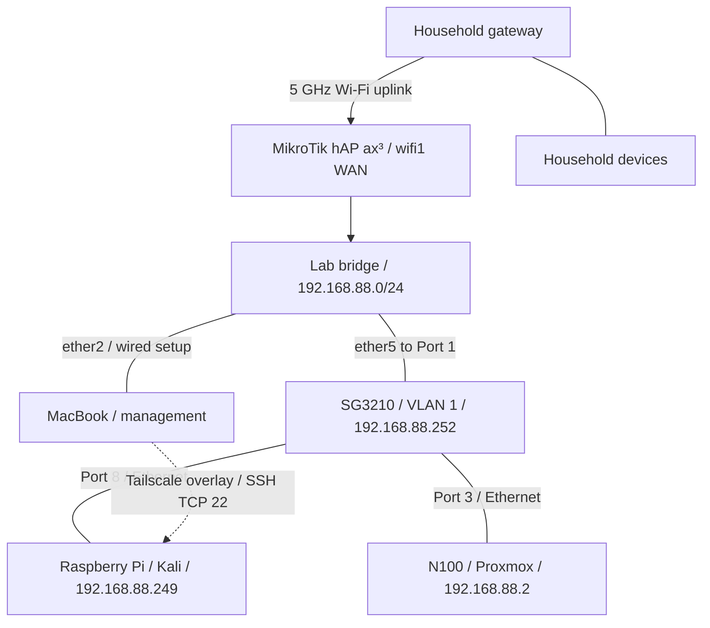

# HomeLab — Networking and Virtualization

I'm building a home lab to turn my CompTIA Network+ studies into practical experience with networking, Linux, virtualization, and security. This repository documents the build from hardware preparation and MikroTik configuration through Proxmox installation, switch integration, firewall isolation, remote Linux administration with Tailscale, and hardening the MacBook used to manage the lab.

The focus is on the decisions, troubleshooting, and results: what I changed, why I changed it, what I verified, and what still needs work.

**Latest documented milestone:** The MacBook firewall is enabled, login and app permissions have been reviewed, and SSH to the Pi was verified after the firewall change. Chrome can now reach the switch. I verified the SG3210 hardware and shared VLAN 1, reserved its management address at `192.168.88.252` through MikroTik DHCP, labeled Ports 1, 3, and 8, saved the configuration, and downloaded an updated switch backup. The lab remains one LAN; the first VM and further management-service review remain open.

*Latest documented work: October 15, 2026. README updated October 16, 2026. This overview reflects the published phases through Phase 7, not a live inventory. Later collaborator onboarding and SSH-key work are reserved for a separate phase. Earlier plans and pending tasks should be read alongside later outcomes.*

## Project documentation

| Phase | What it covers | Outcome at the end of that phase |
| --- | --- | --- |
| [01 — Planning, Hardware, and Preparation](docs/01-planning-and-hardware.md) | Equipment, installation prerequisites, workspace constraints, the unknown Windows software baseline, and initial household-network checks | Core equipment received; dedicated router and clean server installation selected |
| [02 — MikroTik Wireless WAN and Lab Network Setup](docs/02-network-setup.md) | Station-mode uplink, bridge membership, DHCP, WAN interface lists, NAT, and USB preparation | Internet browsing verified from the wired MacBook; Proxmox USB prepared |
| [03 — Proxmox VE Installation](docs/03-proxmox-installation.md) | USB boot, disk selection, management NIC and static IP, hostname discrepancy, first local login, and shutdown | Proxmox installed and booted; local root login succeeded |
| [04 — Switch Integration and Proxmox Operations](docs/04-switch-and-proxmox-operations.md) | Confirmed cabling, layered connectivity tests, Safari access, repository authorization failures, updates, reboot, and storage checks | Switch path and browser login verified; host updated; cable organization and first VM still pending |
| [05 — Lab Isolation and Firewall Troubleshooting](docs/05-lab-isolation-and-firewall.md) | Power reconnection, flat-LAN decisions, upstream checks, IPv4/IPv6 forwarding rules, Safe Mode rollback, and macOS route troubleshooting | Rules saved; household-gateway drop verified by counters; Tailscale and broader isolation tests pending |
| [06 — Raspberry Pi, Tailscale, and Remote Access](docs/06-raspberry-pi-and-tailscale.md) | DHCP discovery, headless SSH, Tailscale account migration, external access, policy restrictions, user accounts, Kali updates, and reboot checks | Remote SSH verified; policy saved; Pi updated; collaborator VPN access pending |
| [07 — MacBook Hardening and Switch Management](docs/07-macbook-hardening-and-switch-management.md) | MacBook firewall and permissions, switch browser access, hardware/VLAN inspection, DHCP reservation, port descriptions, Save, and configuration exports | MacBook baseline improved; switch management established and backed up; shared VLAN 1 retained |

## Lab hardware

| Component | Role and recorded details |
| --- | --- |
| PELADN WI-6 mini PC | Proxmox host: Intel N100, 4 cores, 8 GB RAM, 256 GB SSD |
| MikroTik hAP ax³ | Lab router, US version; 5 GHz Wi-Fi uplink and a separate lab LAN |
| TP-Link TL-SG3210 JetStream | SG3210 hardware 3.20; 8 Gigabit copper ports + 2 SFP slots; Port 1 uplink, Port 3 to Proxmox, Port 8 to Pi; management `192.168.88.252` reserved through DHCP |
| MacBook Pro with UGREEN USB-C hub | `MacBookPro16,1`, 8-core Intel Core i9, 16 GB RAM; local lab administration and Tailscale/SSH management; FileVault on and firewall enabled |
| SanDisk USB drive | Proxmox installation media, written using Raspberry Pi Imager |
| Monitor and keyboard | Local installation and console access |
| Raspberry Pi | Headless Kali Rolling 2026.2 ARM64 client; LAN `192.168.88.249` via DHCP; Tailscale endpoint for remote SSH |

Phase 7 confirmed the switch as **SG3210 hardware 3.20** and inspected its existing **VLAN 1 / PVID 1** configuration. All ten listed interfaces, including the two SFP slots, were untagged members of that VLAN. Phase 6 confirmed the Pi's Kali installation and connection on **Port 8**. The Pi serves as a lab client and remotely accessible endpoint; it is not configured as a subnet router.

## Network layout

The MikroTik joins the household network through its 5 GHz radio, `wifi1`, in **station** mode. Its lab LAN uses `192.168.88.0/24`. The switch connects the N100 on Port 3 and the Pi on Port 8. The MacBook uses router `ether2` for wired setup; remote Pi access was also verified with that cable disconnected.

| Physical connection | Confirmed mapping |
| --- | --- |
| Router → switch | MikroTik `ether5` → Switch Port `1` |
| Switch → server | Switch Port `3` → N100 Ethernet |
| Management computer → router | MacBook Ethernet adapter → MikroTik `ether2` during wired setup |
| Switch → Raspberry Pi | Switch Port `8` → Pi `eth0` |

| Setting | Latest documented value |
| --- | --- |
| MikroTik LAN address / gateway | `192.168.88.1` |
| Lab DHCP pool | `192.168.88.10`–`192.168.88.254` |
| Proxmox static address | `192.168.88.2/24` |
| Pi LAN address | `192.168.88.249/24`; dynamic DHCP snapshot |
| Switch management address | `192.168.88.252`; static DHCP lease on MikroTik, switch remains a DHCP client |
| Switch management URL | `https://192.168.88.252`; login verified through Chrome; certificate trust warning remains |
| Switch VLAN / PVID | VLAN 1 (`System-VLAN`), untagged ports `1/0/1`–`1/0/10`; PVID 1 throughout |
| Proxmox configured gateway / DNS | `192.168.88.1` |
| Proxmox management interface | `nic0`, Ethernet driver `r8169` |
| Proxmox management URL | `https://192.168.88.2:8006` — login verified through Safari |
| Router LAN bridge members | `ether2`–`ether5`, `wifi2` |
| Router WAN interface-list members | `ether1`, `wifi1`; `ether1` unused during setup |

Phase 5 added an IPv4 forward drop to the household subnet, a drop for new forwarded WAN connections, and an IPv6 forward drop before FastTrack6. The household-gateway client test matched **3 packets / 252 bytes**; saving the rules was confirmed. Deliberate inbound-WAN and routed-IPv6 tests remain pending. Existing general internet egress was retained; this is not an update-repository allowlist. The bridge and internal single-LAN design remain unchanged.

The dotted edge represents the Tailscale overlay, not an additional physical cable. Remote SSH was tested from a phone hotspot and from household Wi-Fi. No public port forward or advertised lab-subnet route was added. Tailscale policy controls the overlay path; it does not isolate devices sharing the lab LAN.

## Troubleshooting highlights

| Problem | Change made | Observed result |
| --- | --- | --- |
| DHCP client could not run on `wifi1` because it remained a bridge member | Removed only `wifi1` from the LAN bridge | Upstream DHCP lease obtained |
| Router had an upstream address, but the wired client could not browse | Added `wifi1` to the WAN list used by the existing masquerade rule | Browsing succeeded from the MacBook on `ether2` |
| balenaEtcher could not open the ISO | Switched to Raspberry Pi Imager / Use Custom | Installation USB written successfully |
| Startup key attempts did not reach the USB boot menu | Used Windows Shift + Restart and selected UEFI USB PARTITION 2 | Proxmox installer started |
| Installer addressing did not match the lab network | Set `192.168.88.2/24`, outside the DHCP pool | Installed system displayed the expected management URL |
| Chrome could not reach Proxmox in Phase 4 | Checked ping, TCP 8006, and HTTPS, then used Safari | Safari login succeeded; Proxmox access from Chrome was not retested in Phase 7 |
| Update task failed with exit code 100 | Ran `apt update` on Proxmox; found 401 errors; disabled PVE/Ceph Enterprise and added PVE No-Subscription | Refresh returned TASK OK; later upgrade completed |
| First upgrade attempt aborted at confirmation | Retried with guidance to use the default confirmation or English `y` | Upgrade completed; subsequent reboot and new kernel were verified |
| Cable unplugged while RouterOS was in Safe Mode | Inspected rule presence and history, then reapplied missing rules | Rollback confirmed; final changes later saved |
| Household ping timed out but the drop counter stayed at zero | Inspected macOS routes; disabled the Wi-Fi network service for the Ethernet-only test | Household drop counter increased to 3 packets / 252 bytes |
| First SSH connection to the Pi closed before a password prompt | Retried with `ssh -v` and inspected the handshake | Password login succeeded; original closure remained unexplained |
| Pi was already enrolled in a collaborator's tailnet | Logged it out over the LAN session and authenticated it into my own account | Pi and MacBook joined the same owner-controlled tailnet |
| Tailnet policy allowed unrestricted connections | Backed up the policy and limited access to the specified MacBook → Pi TCP 22 | Policy saved; a fresh SSH login succeeded |
| Collaborator account password failed during creation | Completed account creation, then set its password separately | Login and UID/group checks succeeded from my authorized MacBook |
| Post-reboot login rejected several passwords | Corrected a typing error | Remote SSH worked again; no firewall or VPN reset needed |
| Chrome could not reach the switch despite successful ping and TCP 80/443 checks | Enabled Chrome's macOS Local Network permission | HTTPS switch login became reachable; its certificate trust warning remained |
| Switch management depended on a dynamic lease | Converted the matching DHCP lease to static on MikroTik | Address remained `192.168.88.252`, status `bound`, with the entry's `D` flag removed |
| Port numbers alone made equipment identification inconvenient | Added descriptions for Ports 1, 3, and 8, then used Save and Export | Main connections labeled; updated switch backup downloaded |

## Proxmox snapshot after the Phase 4 upgrade

The following values were recorded on October 7, 2026. They describe that session, not a continuously monitored state or a recommendation to install a particular version.

| Item | Recorded value |
| --- | --- |
| Proxmox Manager | `pve-manager/9.2.21` |
| Running kernel | `Linux 7.0.14-20-pve` |
| Boot mode | EFI |
| Active repositories | Debian + Debian security + PVE No-Subscription |
| Disabled repositories | PVE Enterprise and Ceph Squid Enterprise |
| `local` | `72.73 GB` total; `6.24 GB` used |
| `local-lvm` | `151.66 GB` total; `0 B` used |
| Guests | No VM or container created yet |

The No-Subscription production-use warning remained visible. A new package-list refresh after the post-reboot inspection was not recorded; the successful upgrade is documented in Phase 4.

## Raspberry Pi snapshot after Phase 6

Recorded on October 10, 2026:

| Item | Recorded state |
| --- | --- |
| OS / architecture | Kali Rolling 2026.2 / ARM64 |
| Running kernel after reboot | `6.12.34+rpt-rpi-2712`; unchanged from the initial check |
| Remote access | Ordinary OpenSSH over Tailscale, with Linux password authentication |
| External test | Fresh login from phone hotspot with Ethernet disconnected |
| Policy | Specified MacBook → Pi TCP 22; collaborator access not yet granted |
| Accounts | Administrator password changed; separate collaborator account created, UID/GID 1004, no `sudo` group membership shown |
| Approved upgrade plan | 1461 upgrades, 80 installs, 2 removals, 1 package not upgraded |
| Package consistency checks | `dpkg --audit` returned no findings; `apt-get check` completed without errors before reboot |
| Post-reboot checks | `ssh` and `tailscaled` active; no failed systemd units |

The account and service review was a basic security baseline, not proof that the Pi was free of malware. The successful collaborator-account test was performed from my MacBook; their own device had not yet been authorized. The exact policy structure, test results, and remaining limits are recorded in [Phase 6](docs/06-raspberry-pi-and-tailscale.md).

## MacBook and switch snapshot after Phase 7

Recorded during October 10–15, 2026:

| Area | Documented state |
| --- | --- |
| MacBook baseline | macOS `26.7.1`, build `25G241`; no DEP/MDM enrollment reported |
| MacBook protection | FileVault already on; firewall enabled; login password changed; automatic login off |
| App permissions | Chrome/Zoom microphone and reviewed camera permissions off; Zoom screen recording and background activity disabled |
| Previous owner's data | Preserved; backup confirmation required before deletion |
| Switch identity | SG3210 hardware `3.20`; System Summary firmware `3.20.0 Build 20230818 Rel.72032` |
| Switch management | HTTPS login reached; new password set; management address reserved in MikroTik DHCP |
| Network configuration | Shared VLAN 1 and PVID 1 inspected and retained; no inter-VLAN routing added |
| Port descriptions | `1/0/1`: `MikroTik-ether5`; `1/0/3`: `Proxmox-N100`; `1/0/8`: `RaspberryPi-Kali` |
| Configuration handling | Save confirmed; initial and updated switch exports downloaded |
| Remaining checks | Certificate trust, management services, time settings, firmware review, restart persistence, and restore test |

The switch export does not include its DHCP reservation, which lives on the MikroTik. A post-change router export is still an open documented task. The Chrome fix was verified against the switch; it did not constitute a new Proxmox browser test. See [Phase 7](docs/07-macbook-hardening-and-switch-management.md) for the evidence and limits.

## Status and next work

- [x] Prepare the main hardware and installation accessories.
- [x] Configure the MikroTik wireless uplink and lab LAN.
- [x] Resolve DHCP and NAT configuration issues; verify wired-client internet access.
- [x] Prepare the Proxmox installation USB.
- [x] Replace Windows with Proxmox on the internal SSD.
- [x] Configure static management addressing and verify local root login.
- [x] Initiate an orderly shutdown using `poweroff`.
- [x] Integrate the switch and verify the physical path with ping and TCP checks.
- [x] Verify browser access from the MacBook through Safari.
- [x] Correct the update repositories, complete the upgrade, and reboot into the new kernel.
- [x] Inspect the node and the `local` / `local-lvm` storage figures.
- [x] Reconnect the equipment using the temporary integrated-cord power strip arrangement.
- [ ] Complete the final cable layout and labeling; record a full connectivity recheck.
- [x] Restore Chrome access to the switch by enabling its Local Network permission.
- [ ] Retest Chrome access to Proxmox separately; the earlier Safari login remains the verified Proxmox browser path.
- [ ] Verify the full hostname: `proxmox.lab.local` was entered, while `proxmox` was displayed.
- [x] Identify the switch as SG3210 hardware 3.20 and record the displayed firmware.
- [x] Inspect and document shared VLAN 1, untagged membership, and PVID 1 without changing the design.
- [x] Set a new switch management password and verify HTTPS login.
- [x] Reserve `192.168.88.252` for the switch in MikroTik DHCP.
- [x] Describe Ports 1, 3, and 8; confirm Save and download an updated switch export.
- [ ] Review switch time settings, firmware suitability, and management services.
- [ ] Validate switch restart persistence and backup restoration in a planned maintenance window.
- [x] Review the MikroTik policy, apply lab isolation rules, and verify the household-gateway drop counter.
- [x] Confirm that the final Safe Mode changes were saved.
- [ ] Test inbound-WAN blocking, routed IPv6 behavior, and HTTPS again with the test client using only the lab path.
- [ ] Create and download a post-change router export, including the switch DHCP reservation; completion has not been recorded.
- [x] Transfer the Pi's existing Tailscale enrollment to my account and enroll the MacBook.
- [x] Verify remote SSH from a phone hotspot with lab Ethernet disconnected.
- [x] Save a restricted MacBook-to-Pi tailnet policy and test a fresh SSH login.
- [x] Review Pi services, listeners, accounts, and SSH authentication settings.
- [x] Change the administrator password and verify a new login.
- [x] Create and test a separate collaborator account from my authorized MacBook.
- [x] Upgrade Kali, reboot, and verify remote access and active services.
- [ ] Complete and document the separate collaborator-access phase, including a successful test from their own device.
- [ ] Configure and test individual SSH keys; back up the Pi configuration and updated tailnet policy.
- [x] Review the MacBook inventory, FileVault state, and management enrollment.
- [x] Enable the MacBook firewall and confirm that SSH to the Pi still works.
- [x] Review sharing, app permissions, background items, and browser settings; change the login password.
- [ ] Confirm the previous owner's backup before deleting personal files.
- [ ] Confirm off-device access to the FileVault recovery key; a recovery test has not been recorded.
- [ ] Decide separately whether remote Proxmox access or broader subnet routing is needed.
- [ ] Upload an ISO and create the first lightweight Ubuntu VM; final guest configuration remains undecided.
- [x] Verify the Raspberry Pi's OS, address, Ethernet connection, and SSH access.
- [ ] Expand into additional Linux VMs, containers, and network exercises.

## Security and documentation approach

The initial seller-provided Windows installation was replaced to establish a known software baseline. Its earlier connection to household Wi-Fi was not evidence of a compromise; the basic household-device checks did not constitute a forensic investigation.

UPnP was found enabled during a later pre-installation check and was turned off. The latest recorded state is **Off**. No public Proxmox or SSH port-forwarding rule was configured. Phase 5 added the MikroTik forwarding rules; Phase 6 established ordinary SSH over Tailscale to the Pi and narrowed the tailnet policy. Phase 7 enabled the MacBook firewall, reduced app permissions, and organized switch management. These controls do not automatically isolate same-LAN devices from one another or route a computer's independent household Wi-Fi connection through the lab. No lab-subnet route was advertised through Tailscale.

Passwords, authentication URLs, household SSIDs, account email addresses, MAC addresses, and personal household-device inventories are omitted. Private LAN addresses are retained to make addressing and troubleshooting understandable. Phase 6 uses clearly marked example Tailscale IPs and a normalized collaborator username; Phase 7 retains that convention and substitutes `<SWITCH_MAC>` in the DHCP template. Actual identifiers remain in the private working record. Recovery keys and raw router/switch configuration backups are not included. The documents distinguish completed actions, planned work, and unresolved observations.

## Skills practiced

IP addressing and DHCP · Wireless client configuration · Bridge membership · Interface lists and NAT · Switch integration and port mapping · ICMP/TCP/HTTPS troubleshooting · Bootable installation media · OS installation · Linux console access · Package repositories and host updates · Storage inspection · Stateful firewall rules · Safe Mode recovery · macOS routing diagnosis · Firewall-counter validation · Headless Linux administration · SSH authentication inspection · Tailscale enrollment and access policy · External-access testing · Linux user management · tmux-assisted upgrades · Post-reboot validation · macOS firewall and privacy review · Browser local-network troubleshooting · VLAN/PVID inspection · DHCP reservations · Switch port descriptions · Configuration saving and backup · Technical documentation

These are hands-on learning records. Detailed configuration values describe this lab's setup and should be interpreted in the context of each phase.
