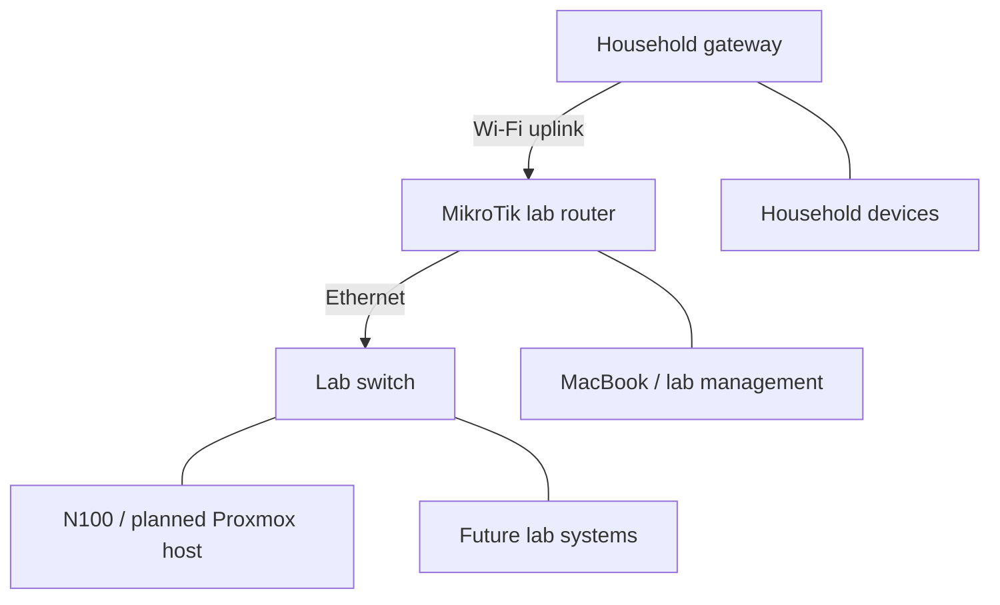

# Phase 1 — Planning, Hardware, and Preparation

This phase covers the initial hardware purchases, installation prerequisites, workspace preparation, first boot of the mini PC, and the decision to configure a dedicated lab network before installing Proxmox VE.

**Outcome:** The core equipment and MacBook adapter had arrived, power had been routed to the lab area, and basic checks of the household devices and gateway had been completed. Proxmox VE was selected as the server platform. Router configuration and OS installation remained the next stages.

> **Historical scope:** This is a record of the preparation phase, based on project notes compiled on October 3, 2026. Planned configurations are explicitly identified below. This page does not describe the final deployed network or claim that Proxmox was already installed.

## 1. Project goals

I started this home lab to turn my CompTIA Network+ studies into practical experience and build a foundation for server administration and cybersecurity work.

The intended learning goals were to:

- Connect and configure a router and switch.
- Practice IP addressing, routing, DHCP, DNS, VLANs, and firewall rules.
- Run virtual machines and containers.
- Manage lab systems from a MacBook without a permanent monitor and keyboard on every device.
- Control communication between experimental systems and household devices.

The operating system and the final role of every component had not been settled at the start.

## 2. Hardware inventory

Equipment was purchased gradually, including through eBay. The initial focus was on the main hardware; the adapters, installation media, and cabling requirements became clearer during preparation.

| Component | Details recorded during this phase | Intended role / qualification |
| --- | --- | --- |
| Mini PC | PELADN WI-6; Intel N100; 8 GB RAM; 256 GB SSD | Primary lab server. Memory and storage were recorded from the listing at this stage. |
| Existing operating system | Seller-provided Windows installation | To be replaced with a clean installation. |
| Switch | TP-Link TL-SG3210, as identified in the preparation notes | Wired connectivity for lab devices; verify the physical model label before configuration. |
| Lab router | MikroTik hAP ax³ | Ordered later in the process and reported received; intended to provide a wireless uplink and a separate lab LAN. |
| Management computer | MacBook | Download installation media, prepare the USB drive, and manage the server. |
| USB-C adapter | UGREEN hub with USB, HDMI, and Ethernet connections | Connect USB-A installation media and, when needed, Ethernet to the MacBook; arrival confirmed. |
| Monitor and keyboard | Available for the mini PC | Local installation and initial configuration. |
| Additional systems | Raspberry Pi and other computers were mentioned | Future expansion; exact models and specifications were not verified in this phase. |

Earlier planning included other possible devices. A proposed purchase is not evidence that a device was acquired; unverified equipment needs to be checked against its label before it is configured or added to the final inventory.

## 3. Installation prerequisites

### USB installation drive

A USB drive was needed to boot the mini PC into an operating system installer.

The planned process was to download an ISO and write it to the USB drive using an image-writing tool. Simply copying the ISO file to an ordinary USB drive was not the method planned here. Writing the image would erase the selected USB drive.

A drive of **16 GB or larger** was suggested as a convenient choice, not as a verified minimum requirement for Proxmox. The USB drive would be temporary installation media; the operating system would ultimately be installed on the mini PC's internal SSD.

### MacBook adapter and other accessories

The MacBook needed an adapter for USB-A devices and potentially a wired Ethernet connection. A UGREEN USB-C hub was selected and later arrived.

New and used purchase options were considered. The recorded prices were $18.99 new and $17.85 used, a difference of $1.14. The new option was recommended because the saving was small relative to possible connector or cable wear. There was no evidence that a particular used adapter had been maliciously modified.

Other required items included Ethernet cables, an HDMI cable, a USB keyboard, and the appropriate power supply or power cable for each device.

## 4. Workspace and power preparation

The lab location was a storage closet approximately two rooms away from the household router. It had two practical limitations:

1. No power outlet inside the lab area.
2. No Ethernet cable running from the household router to the lab, with a preference for a wireless connection between the rooms.

A power cable was routed from an existing outlet toward the lab along the wall and baseboards. Cable clips, cable concealment, and the doorway transition were discussed. A later photo confirmed that the cable had been routed.

**Verification limit:** Cable rating, grounding, allowable load, and the final power-strip connection were not verified in the preparation record. The work is documented as cable routing, not as an inspected or certified electrical installation. Checking the cable or packaging for its A, W, and AWG markings remained an open item.

## 5. First boot and the trust concern

The mini PC was connected to power and the monitor, then started with the Windows installation supplied by the seller. During initial setup, it requested network access and was connected to the household Wi-Fi.

At that point:

- No clean OS installation had been performed.
- No separate lab network had been configured.
- No isolation between the mini PC and household devices had been established.

This raised a trust question: the software state of the seller-provided installation was unknown, and the machine had joined the same local network as household devices.

**Connecting to Wi-Fi did not establish that the machine was infected or that a vulnerability had been exploited.** The concern was uncertainty about the existing installation and the absence of network isolation. A household router's internet-facing firewall should not be assumed to block communication between devices on the same local network.

## 6. Disconnecting the mini PC

Windows showed two saved Wi-Fi profiles: the household network and an unfamiliar network whose origin was not verified. A previous use of the PC was a possible explanation, not a confirmed finding.

The **Forget** action was performed on both profiles. The accompanying instructions were to disable Wi-Fi and ensure that no Ethernet connection remained active. Later, the household gateway's device list showed the mini PC as **Off**.

Two distinctions mattered during troubleshooting:

- Two saved profiles do not mean two simultaneous active connections.
- A saved profile for a previous network does not, by itself, give that network's owner access to the PC or the household network.

Forgetting a network removes its saved connection profile; it is not a malware scan or a substitute for a clean installation.

## 7. Basic checks of household systems

After disconnecting the mini PC, basic checks were performed on my MacBook. A check of the second household MacBook was also reported, although equally detailed results were not recorded for that device.

| Check | Observation or action recorded |
| --- | --- |
| Sharing and remote access | File Sharing, Screen Sharing, Remote Login, and Remote Management were reported disabled on my MacBook. |
| macOS updates | An available update was started; completion was not confirmed in this phase's record. |
| Login Items & Extensions | Open at Login was empty. Background entries named Google and Zoom, and extensions associated with Apple applications, were visible. |
| Application updates | A Zoom update notification appeared; updating was recommended. |

The review also clarified that sharing extensions are not the same setting as enabling network file sharing. Familiar application names were useful context, but names alone did not authenticate the software.

**Result:** No suspicious sign was identified in the screens reviewed. These were basic configuration checks, not a documented full malware scan, forensic examination, or network traffic analysis. They could not prove that no security event had occurred.

## 8. Household gateway review

### Correcting the hardware identification

The household router was initially described as a Spectrum device. Its administration interface showed **AT&T**, and the device was subsequently identified as an **AT&T BGW320-505**.

The observed local management address was `192.168.1.254`. Later planning used the hardware identified in the interface. Whether the fiber connected directly to the gateway or through a separate ONT was not established in this phase.

### Observed settings

| Area | State recorded |
| --- | --- |
| Broadband | Up |
| Wireless bands | 2.4 GHz and 5 GHz active under the same SSID |
| Wireless security | WPA2 |
| Guest network | Disabled |
| Packet Filter | On |
| IP Passthrough | Off |
| NAT Default Server | Off |
| Firewall Advanced | On |
| NAT/Gaming | “No Application Hosting entries have been defined.” |
| Remote Access | The page offered **Enable Remote Access**, indicating that the feature was not enabled at the time; it was not enabled during the review. |

The client list contained both current and historical device records. The mini PC appeared offline, and the Samsung TV was identified by matching its IP address. An **On/Off** state was more informative than a Wi-Fi signal icon alone. Client addresses observed at that moment were not treated as permanent assignments.

The service name **Act of War - Direct Action** appeared in a selectable NAT/Gaming template list. It was an available configuration template, not evidence of installed software or an active connection.

**Result:** Nothing suspicious was identified in the reviewed client list and settings. There was no basis in those observations to conclude that the household network had been compromised simply because the mini PC had connected to it.

Household SSIDs, personal device names, and the full household client-address list are intentionally omitted from this public-facing version.

## 9. Choosing a clean server installation

The decision was to replace the seller-provided Windows installation with an operating system obtained from an official source, establishing a known software baseline.

Windows and Linux were considered initially. The project then settled on **Proxmox VE** to run virtual machines and containers on the N100.

The intended roles were:

- **N100:** Run Proxmox directly on the hardware.
- **Guest systems:** Run operating systems such as Ubuntu inside virtual machines later.
- **MacBook:** Prepare installation media and manage Proxmox through a browser.

Windows did not need to be manually erased first. The planned Proxmox installation would erase the selected installation disk, making correct target-disk identification essential.

A clean installation was a baseline decision, not a finding that the previous system contained malware.

## 10. Selecting the network approach

The lab needed both a wireless connection to the household network and wired Ethernet connections for its servers. A conventional Ethernet switch alone would not provide that wireless uplink or automatically isolate the lab.

The **MikroTik hAP ax³** was selected to provide the uplink and a separately configured lab LAN.

### Proposed topology — not yet deployed

The diagram represents intended connections. It does not show verified isolation or imply that all devices had already been connected.

### Proposed cable mapping

| Connection | Intended destination |
| --- | --- |
| MikroTik `ether2` | Switch port 1 |
| Switch port 2 | N100 Ethernet interface |
| Additional switch ports | Other computers or Raspberry Pi |
| N100 HDMI | Monitor for installation |
| N100 USB | Keyboard and installation drive |

`ether1` was left unused in this initial cabling proposal. PoE was not required for the proposed setup; devices were to use their appropriate individual power supplies or power cables. The MacBook would join the lab network for management.

### Planned isolation requirements

The intended policy was to allow internet access from the lab while blocking unwanted access from lab devices to the household network.

A second router, NAT, or a different Wi-Fi name alone would not establish that policy. Firewall rules needed to be configured and tested, including IPv6 behavior if IPv6 was active. No applied rule set or successful isolation test was recorded in this phase.

## 11. Changing the implementation order

Once the lab router arrived, the sequence changed to **network configuration first, Proxmox installation second**:

1. Perform initial MikroTik configuration.
2. Connect its wireless uplink to the household network.
3. Define the lab LAN and network services.
4. Verify wired connectivity and internet access.
5. Configure and test separation from the household network.
6. Select suitable Proxmox management addressing.
7. Install Proxmox on the N100.

The reason was practical: the Proxmox installer asks for a management interface, IP address, default gateway, and DNS server. Defining the target network first would reduce avoidable address changes afterward.

This was the project's chosen sequence, not an absolute requirement to configure a router before installing Proxmox.

## 12. Installation workflow planned at this stage

The initial USB preparation instructions used **balenaEtcher** on the MacBook:

1. Download the Proxmox VE ISO Installer from the official source, using the `x86_64` / `AMD64` architecture appropriate for the Intel N100.
2. Obtain the appropriate Mac version of balenaEtcher.
3. Connect the installation USB drive through the adapter.
4. Select **Flash from file** and choose the ISO.
5. Use **Select target** and verify the USB drive by its name and capacity.
6. Select **Flash!** and wait for writing and validation to finish.
7. Move the USB drive to the N100 and select it through the boot menu.
8. Choose **Install Proxmox VE (Graphical)**.

`ext4` was suggested as a straightforward initial filesystem choice for the internal drive. The correct boot-menu key had not yet been verified.

**Status:** These were preparation instructions only. This phase did not confirm that balenaEtcher successfully wrote the USB drive, that Windows was erased, or that Proxmox installation finished. The tool and method actually used belong in the later installation record.

## 13. Completion status and open items

### Completed or reported completed

- Core equipment purchased.
- Mini PC powered on with its existing Windows installation and initially connected to household Wi-Fi.
- Both saved Wi-Fi profiles forgotten; mini PC later observed offline in the gateway client list.
- Basic checks performed on household MacBooks and the gateway.
- Power cable routed toward the lab area.
- MacBook adapter received.
- MikroTik router ordered and reported received.

### Decisions made

- Replace the existing OS with Proxmox VE.
- Prepare installation media using the MacBook.
- Build a separate lab LAN with controlled access to the household network.
- Configure the MikroTik before proceeding with Proxmox installation.

### Not yet confirmed in this phase

- Physical model verification for the switch and additional computers.
- Electrical ratings and final power distribution arrangement.
- Final lab subnet, DHCP pool, and Proxmox management address.
- Applied firewall rules and tested isolation, including IPv6 if used.
- Successfully written installation media and completed Proxmox installation.

The address `192.168.50.10` had appeared in SSH and port explanations as an **example only**. It was not an assigned server address. Similarly, TCP `22` was discussed for SSH and TCP `8080` as an example application port; those discussions did not establish that either service had been configured.

## 14. Lessons from this phase

- Hardware acquisition includes installation media, adapters, cabling, and workspace constraints—not just servers and network devices.
- An unknown software baseline calls for deliberate preparation; it does not establish that an incident occurred.
- Saved Wi-Fi profiles, historical client entries, and service templates need context before they can be interpreted as active connections or threats.
- Network separation is a policy to implement and test, not a property guaranteed by adding a router.
- Deciding on management addressing before installing the server makes the installation easier to document and maintain.
- A useful project record distinguishes observed results, proposed configurations, illustrative values, and unresolved questions.

## Quick reference

| Item | Phase 1 record |
| --- | --- |
| Primary host | PELADN WI-6 / Intel N100 |
| Listed memory and storage | 8 GB RAM / 256 GB SSD |
| Selected server platform | Proxmox VE, installation pending |
| Installer architecture | `x86_64` / `AMD64` |
| Installation preparation computer | MacBook |
| Initially proposed USB writer | balenaEtcher; successful use not confirmed here |
| Lab router | MikroTik hAP ax³ |
| Recorded switch | TP-Link TL-SG3210; physical verification pending |
| Identified household gateway | AT&T BGW320-505 |
| Observed household gateway address | `192.168.1.254` |
| Planned uplink | Household Wi-Fi to MikroTik |
| Planned host connection | Ethernet through the lab switch |
| Isolation status | Planned; rules and verification pending |
| Next phase | Configure the lab router and record actual interfaces, IP addressing, DHCP, DNS, NAT, and firewall behavior |

*Source: Phase 1 preparation notes. This English repository version preserves the technical decisions and their verification limits while omitting household identifiers and credentials.*
