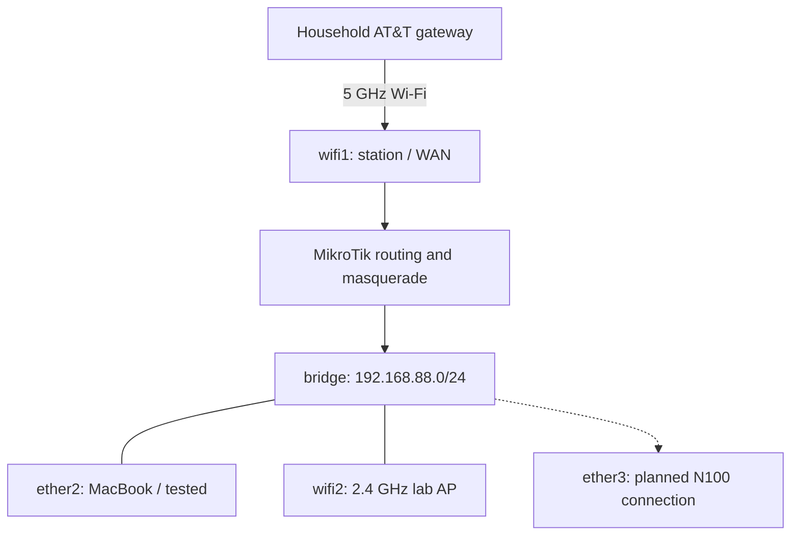

# Phase 2 — MikroTik Wireless WAN and Lab Network Setup

This phase documents configuring a MikroTik hAP ax³ to use household Wi-Fi as its internet uplink, troubleshooting DHCP and NAT, and preparing the USB installer for the lab server.

**Outcome:** The router joined the household wireless network, obtained an upstream DHCP lease, and provided working internet access to the MacBook connected to its LAN. A SanDisk USB drive was successfully prepared for Proxmox installation using Raspberry Pi Imager.

> **Historical scope:** This record is based on the network setup notes compiled on October 3, 2026. Proxmox installation was still the next step. Internet connectivity was tested; comprehensive isolation from household devices was not demonstrated in this record.

Previous phase: [Planning, Hardware, and Preparation](01-planning-and-hardware.md).

## 1. Objective and network design

The lab needed a dedicated network without running an Ethernet cable back to the household gateway. I configured the **MikroTik hAP ax³, US version, with Wi-Fi 6** to connect wirelessly to the household AT&T network and provide wired and wireless connectivity on the lab side.

| Network component | Role |
| --- | --- |
| Household AT&T network | Upstream wireless network and internet connection |
| `wifi1` | 5 GHz radio in `station` mode; wireless WAN uplink |
| MikroTik routing, NAT, and firewall | Traffic processing between the upstream network and the lab LAN |
| `bridge` | Lab LAN, `192.168.88.0/24` |
| `ether2`–`ether5` | Wired lab LAN ports |
| `wifi2` | 2.4 GHz access point on the lab LAN |

### Topology at the end of this phase



`ether4` and `ether5` also remained in the LAN bridge. The N100 connection shown above was the proposed next step, not a connection verified by this phase's browsing test. The diagram shows network roles, not a verified security boundary.

## 2. Initial connection and administration

1. Attached both antennas before powering on the router, following the warning on the device.
2. Connected the MacBook by Ethernet to **`ether2`**.
3. Left **`ether1`** disconnected because it retained its default wired WAN role.
4. Connected power and waited for startup.
5. Opened the router's management interface at **`192.168.88.1`** from the MacBook.

Initial login used the `admin` account and the device-specific password from the label. The label's **Password** field was distinct from **WiFi key**. No password values are included in this documentation.

In **Quick Set → Home AP Dual**, I changed **Country** to **United States** and changed the MikroTik Wi-Fi password. WPS was not used. The changes were saved with **Apply Configuration**.

The following settings were recorded as retained during this initial setup:

| Setting | Recorded value |
| --- | --- |
| Local IP | `192.168.88.1` |
| Netmask | `255.255.255.0` (`/24`) |
| DHCP Server | On |
| DHCP range | `192.168.88.10`–`192.168.88.254` |
| NAT | On |
| UPnP | Off |
| Firewall Router | On |

These values describe the setup session, not a complete RouterOS configuration export. The RouterOS version was not recorded in this source.

## 3. Assigning the wireless uplink

### Identify the radios

In **Advanced → WiFi**, the **Radios** tab identified the two interfaces:

| Interface | Radio | Selected role |
| --- | --- | --- |
| `wifi1` | 5 GHz | Upstream wireless client |
| `wifi2` | 2.4 GHz | Lab access point |

`wifi1` was chosen for the uplink based on the strong signal observed during setup and the intended use of 5 GHz for that connection. This was a design choice, not a throughput benchmark.

### Change from AP to station mode

The `wifi1` **Mode** setting was changed from `ap` to `station`:

```text
Interface: wifi1
Mode: station
```

This changed its role from serving wireless clients to joining another access point as a wireless client. It did not, by itself, complete routing or NAT configuration.

### Scan and select the household network

A scan through `wifi1` displayed the household SSID more than once. The stronger entry, approximately **-38 to -39 dBm**, was selected instead of one around **-50 to -51 dBm**.

The key interpretation was that a less-negative dBm reading indicates a stronger received signal: for example, -39 dBm is stronger than -80 dBm.

After returning from the scan, the SSID field had not been populated automatically. I manually replaced the existing MikroTik SSID in **Configuration** with the household SSID.

Household and device-specific SSIDs are omitted from this public-facing record. Where the household network is referenced below, it means the network selected during this scan.

### Match the upstream security settings

The scan reported **WPA2-PSK**, so `wifi1` was configured to match:

| Security field | Configuration |
| --- | --- |
| Authentication | WPA2 PSK |
| Passphrase | Household Wi-Fi password; omitted |
| WPA3 PSK | Disabled for this connection during setup |

After **Apply**, `wifi1` showed **RUNNING**, which was treated as confirmation of the wireless connection in the setup session. Obtaining an IP address and providing LAN internet access still required additional steps.

## 4. DHCP failure: uplink still inside the LAN bridge

### Symptom

In **IP → DHCP Client**, the existing client on `ether1` showed **Interface not active**, as expected with no WAN cable connected there.

A new DHCP client was added on `wifi1` with:

```text
Interface: wifi1
Use Peer DNS: enabled
Add Default Route: yes
```

RouterOS returned:

```text
DHCP client can not run on slave or passthrough interface
```

### Cause identified

`wifi1` was still a port in the LAN bridge. In that configuration, RouterOS would not run an independent DHCP client on it as attempted.

The bridge membership before the change was:

```text
bridge
  ether2
  ether3
  ether4
  ether5
  wifi1
  wifi2
```

This list is configuration membership, not a physical cabling diagram.

### Change made

In **Bridge → Ports**, I removed **only `wifi1`** from `bridge`.

The MacBook stayed connected to `ether2`, which remained a LAN bridge member. This preserved the management connection while the wireless interface was reassigned to its upstream role.

### Result

After removing `wifi1` from the bridge, the DHCP client already created on that interface obtained an address from the household gateway, with a lease of approximately **24 hours**.

The source captured the address only as `192.168.1.188...`. It was an observed upstream lease, not a static assignment or a fully preserved address-and-prefix record. The important network relationship was an upstream address in the household `192.168.1.x` range and a separate lab LAN at `192.168.88.0/24`.

This confirmed upstream DHCP operation. It did not yet establish that LAN clients could browse the internet.

## 5. LAN internet failure: NAT did not include the wireless uplink

### Symptom

Although `wifi1` now had an upstream IP address, the MacBook connected to `ether2` still could not browse the internet.

### Configuration inspected

In **IP → Firewall → NAT**, an existing rule was found with:

```text
Chain: srcnat
Action: masquerade
Out. Interface List: WAN
```

The rule applied to traffic leaving through interfaces in the **WAN interface list**. `wifi1` had not yet been added to that list.

### Change made

In **Interfaces → Interface List**, I added `wifi1` to `WAN` while retaining the existing entries:

| Interface list | Member | Change |
| --- | --- | --- |
| LAN | `bridge` | Retained |
| WAN | `ether1` | Retained, with no cable connected |
| WAN | `wifi1` | Added |

No replacement NAT rule was needed for this fix. Adding the new uplink to the list allowed the existing masquerade rule to match traffic leaving through it.

### Result

Browsing from the MacBook on `ether2` succeeded after the change.

This was the observed end-to-end test: **wired lab client → LAN bridge → MikroTik routing/NAT → wireless uplink → household gateway → internet**.

## 6. Interface and addressing record

### Interfaces at the end of router setup

| Interface | Role | Recorded state |
| --- | --- | --- |
| `wifi1` | 5 GHz station / WAN | Joined the household Wi-Fi, obtained an upstream DHCP lease, removed from the bridge, added to the WAN list |
| `wifi2` | 2.4 GHz AP / LAN | Remained in `bridge` for lab wireless clients |
| `ether1` | Wired WAN | Remained in WAN list; no cable connected; inactive client/interface state expected |
| `ether2` | Wired LAN | In `bridge`; MacBook connection used for management and the successful browsing test |
| `ether3` | Wired LAN | In `bridge`; proposed connection for the N100 |
| `ether4` | Wired LAN | In `bridge` |
| `ether5` | Wired LAN | In `bridge` |
| `bridge` | Logical LAN interface | Management address `192.168.88.1/24` |

### Lab network settings

| Setting | Value |
| --- | --- |
| Lab subnet | `192.168.88.0/24` |
| Router / default gateway | `192.168.88.1` |
| Subnet mask | `255.255.255.0` |
| LAN DHCP server | Enabled |
| LAN DHCP pool | `192.168.88.10`–`192.168.88.254` |
| Upstream DHCP client | `wifi1` |
| Upstream DNS option | Use Peer DNS enabled |
| Upstream route option | Add Default Route = yes |
| NAT | `srcnat` / `masquerade` / outgoing interface list `WAN` |

Clients connected to `ether2`–`ether5` or the internal lab AP were expected to receive `192.168.88.x` addresses and use `192.168.88.1` as the gateway. The documented successful client test was the MacBook on `ether2`; every port and wireless client was not independently tested in the source record.

## 7. Verification and security limits

| Item | Evidence in this phase | What it established |
| --- | --- | --- |
| Management access | Browser access from the MacBook on `ether2` | The router could be managed through the LAN connection |
| Wireless uplink | `wifi1` showed RUNNING after SSID/security configuration | Wireless connection was established in the recorded session |
| Upstream addressing | DHCP lease appeared on `wifi1` | The router obtained an address from the household network |
| LAN internet access | Browsing succeeded after WAN-list correction | The tested wired client could reach internet services through the router |
| Household-network isolation | No explicit deny-rule listing or blocked-access test recorded | Not verified by this phase |

**Internet access and isolation are different outcomes.** The separate lab subnet and functioning NAT did not demonstrate that lab-initiated access to household devices was blocked. The full firewall rule set, rule ordering, and IPv6 behavior were not captured here. The isolation goal from Phase 1 therefore remained a verification item.

The notes also recommended replacing default management and Wi-Fi credentials because device-label credentials had appeared in setup images. A Wi-Fi password change was recorded; completion of a management-password change was not established by this document. Credentials and setup screenshots containing them are not included here.

## 8. Troubleshooting reference

| Symptom | Checks based on this setup |
| --- | --- |
| `wifi1` is not RUNNING | Verify station mode, household SSID, passphrase, WPA2-PSK compatibility, and signal strength. |
| `wifi1` is RUNNING but has no DHCP lease | Verify that it is no longer a bridge port and that its DHCP client is enabled. |
| DHCP reports a slave/passthrough interface error | Inspect **Bridge → Ports**; in this deployment, removing `wifi1` from the LAN bridge resolved it. |
| Router has an upstream address but LAN clients cannot browse | Check `wifi1` membership in `WAN` and the masquerade rule's outgoing interface-list match. This was the cause found here, not the only possible cause in other setups. |
| `ether1` reports Interface not active | Expected while the wired WAN port has no cable; `wifi1` is the active uplink. |

The existing bridge, LAN DHCP server, and NAT rule were retained. They were central to the working configuration and did not need to be deleted to resolve these issues.

## 9. Server checks and USB preparation

### Hardware and existing Windows installation

Before replacing Windows, the mini PC was checked for:

| Item | Recorded result |
| --- | --- |
| CPU cores | 4 |
| Memory | Approximately 8 GB; 7.8 GB usable shown |
| Virtualization | Enabled |
| Existing operating system | Windows 11 Pro |
| Activation state | Active |
| License message | Digital license linked to the owner's Microsoft account |

These checks supported preparation for a clean Proxmox installation. Windows had not yet been erased at the end of this phase.

### Change of USB-writing tool

A **Proxmox VE 9.2 ISO Installer**, as identified in the source notes, was downloaded to the MacBook. balenaEtcher produced an error while opening the ISO, so the workflow changed to **Raspberry Pi Imager**.

This updated the initial Etcher plan documented in Phase 1. The network setup source does not include the exact error text, so no error string or root cause is inferred here.

In Raspberry Pi Imager:

1. Selected **Use Custom**.
2. Chose the Proxmox ISO.
3. Selected the **SanDisk USB** as the storage target.
4. Left **Exclude system drives** enabled.
5. Wrote the ISO successfully to the USB drive.

The SanDisk was then ready as bootable installation media. This was confirmation of USB preparation, not yet a successful Proxmox installation or boot on the N100.

## 10. End-of-phase status and next step

### Completed

- Initial MikroTik access and regional/Wi-Fi settings.
- `wifi1` configured as a 5 GHz station uplink.
- `wifi1` removed from the LAN bridge.
- Upstream DHCP lease obtained on `wifi1`.
- `wifi1` added to the WAN interface list so the existing NAT rule matched it.
- Successful internet browsing from the MacBook connected to `ether2`.
- Mini PC hardware/virtualization and Windows activation checks.
- SanDisk Proxmox installation media written using Raspberry Pi Imager.

### Next installation task

Connect the N100 to a MikroTik LAN port, with `ether3` proposed in the notes; attach the SanDisk installer; boot from USB; and begin Proxmox VE installation. The target disk must be the mini PC's internal SSD, whose existing Windows installation would be erased.

The Proxmox management IP and installed server state were not established in this phase. After installation, the planned expansion included an Ubuntu Server VM, other Linux virtual machines, containers, and additional lab services.

## 11. Lessons learned

- Changing an interface to station mode does not automatically move it out of the LAN bridge or give it a complete WAN configuration.
- Wireless association, an upstream DHCP lease, and LAN internet access are separate checkpoints.
- Interface-list membership matters when NAT rules match a list instead of a specific interface.
- Keeping the management computer on an unchanged LAN port helped preserve access while reconfiguring the uplink.
- An inactive unused WAN port is not evidence that the active wireless uplink is broken.
- A successful browsing test should be documented separately from security-isolation tests.
- When a planned installation tool fails, record the replacement tool and its actual result rather than leaving the original plan as the final procedure.

## Quick reference

| Item | Phase 2 value |
| --- | --- |
| Router | MikroTik hAP ax³ / US / Wi-Fi 6 |
| Management address | `192.168.88.1` |
| LAN | `192.168.88.0/24` |
| DHCP pool | `192.168.88.10`–`192.168.88.254` |
| Active uplink | `wifi1` / 5 GHz / `station` |
| Uplink security | WPA2 PSK; WPA3 PSK disabled during setup |
| DHCP client | `wifi1`; peer DNS enabled; default route enabled |
| Bridge members | `ether2`, `ether3`, `ether4`, `ether5`, `wifi2` |
| WAN list members | `ether1`, `wifi1` |
| Internal AP | `wifi2` / 2.4 GHz |
| NAT match | `srcnat` → `masquerade`, outgoing interface list `WAN` |
| Tested management/client port | `ether2` |
| Proposed server port | `ether3` |
| USB preparation tool that succeeded | Raspberry Pi Imager / Use Custom |
| Installation media | SanDisk USB with Proxmox ISO |
| Confirmed outcome | Wired LAN internet access; USB prepared |
| Not yet confirmed | Household isolation tests; Proxmox installation |

*Source: Phase 2 router setup notes. This English repository version preserves observed settings, troubleshooting steps, and verification limits while omitting SSIDs and credentials. Configuration blocks describe recorded settings; they are not RouterOS commands or an importable configuration.*
