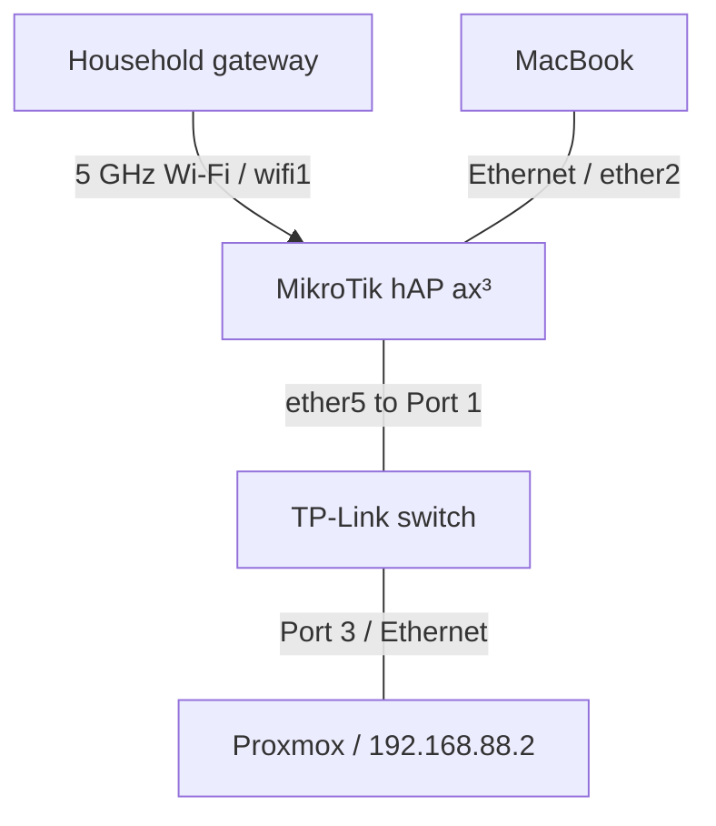

# Phase 4 — Switch Integration and Proxmox Operations

**Result:** The TP-Link switch was added to the lab, Proxmox browser access succeeded through Safari, update repositories were corrected, and the host was upgraded and rebooted. Node and storage checks followed. The next planned step was organizing the equipment and cables before creating the first VM.

> **Historical scope:** This record covers work on October 6–7, 2026, documented on October 7. Commands, outputs, versions, and utilization figures are preserved as reported in that session. Chrome access remained unresolved. No VM, container, Raspberry Pi service, or verified lab-to-household isolation is claimed as completed.

Previous phase: [Proxmox VE Installation](03-proxmox-installation.md). Project overview: [README](../README.md).

## 1. Objective and starting state

The goal was to turn the new Proxmox installation into an accessible, updated platform for the first virtual machine. Phase 3 had ended with successful local `root` authentication; browser access, repository checks, and initial updates were still pending.

| Component | Starting state |
| --- | --- |
| MikroTik hAP ax³ | Lab router at `192.168.88.1`; internet supplied through the household Wi-Fi uplink |
| N100 mini PC | Proxmox installed; 4 CPU cores, 8 GB RAM, 256 GB SSD |
| Proxmox management | Static `192.168.88.2/24`; gateway and DNS `192.168.88.1` |
| MacBook | Management computer connected by Ethernet to the MikroTik LAN |
| TP-Link switch | Not yet in the mini PC's active connection path |
| Raspberry Pi | Not present or connected during this phase |

This was a continuation of the installed system. No OS reinstallation or management-address change was needed.

## 2. Adding the switch and confirming the port mapping

I powered the switch and placed it between the router and the Proxmox host. Earlier suggestions had used other port numbers; the following mapping was confirmed during this phase and supersedes those proposals.

| First endpoint | Second endpoint | Purpose |
| --- | --- | --- |
| MikroTik `ether5` | Switch Port `1` | Switch uplink to the lab LAN |
| Switch Port `3` | Mini PC / Proxmox Ethernet | Server connection |
| MacBook Ethernet adapter | MikroTik `ether2` | Management connection during the work |

The switch extended the lab's Ethernet connectivity. The MikroTik retained the gateway, DHCP, NAT, and existing firewall roles. No switch management login, VLAN configuration, or change to the DHCP service was documented.

Several TP-Link model names had appeared during planning. The physical model was not reverified in this phase, so this record does not assume that model-specific management or VLAN features were tested.



With the MacBook on the lab LAN, management traffic to Proxmox stayed within that LAN; it did not need to cross the household internet connection. Connecting the MacBook only to household Wi-Fi would be a different access path, which was not configured here.

Unplugging an Ethernet cable was distinguished from disconnecting power. An orderly host shutdown was later recommended before moving equipment and disconnecting its power supply.

## 3. Verifying the new network path

Link lights were reported on switch ports `1` and `3`. From the **MacBook Terminal**, I ran:

```bash
ping 192.168.88.2
```

The continuous test returned:

```text
110 packets transmitted, 110 packets received, 0.0% packet loss
round-trip min/avg/max/stddev = 0.804/1.234/10.495/0.903 ms
```

All 110 requests received replies during this measurement, with an average round-trip time of `1.234 ms`. This confirmed IP reachability through the new connection, but did not yet verify the web interface, throughput, or firewall isolation.

**Control + C** was explained as the way to stop the continuous test. A shorter alternative was proposed for later checks:

```bash
ping -c 4 192.168.88.2
```

The recorded 110-packet output belongs to the continuous test, not this four-request alternative.

## 4. Chrome failure, TCP testing, and an HTTPS response

Opening the management URL in Chrome failed despite the successful ping:

```text
https://192.168.88.2:8006/

This site can’t be reached
ERR_ADDRESS_UNREACHABLE
```

Instead of changing the working cabling or IP address, I checked the management service separately. From the **MacBook Terminal**:

```bash
nc -vz 192.168.88.2 8006
```

```text
Connection to 192.168.88.2 port 8006 [tcp/*] succeeded!
```

The Netcat test established a TCP connection to port `8006`. It did not establish that a browser could load and authenticate to the interface.

The next test used curl:

```bash
curl -k -I https://192.168.88.2:8006
```

```text
HTTP/1.1 501 method 'HEAD' not available
Cache-Control: max-age=0
Connection: close
Date: Tue, 06 Oct 2026 15:23:59 GMT
Pragma: no-cache
Server: pve-api-daemon/3.0
Expires: Tue, 06 Oct 2026 15:23:59 GMT
```

`-I` requested headers using `HEAD`. `-k` skipped certificate validation for this diagnostic request to the known local server. The `501` response indicated that `HEAD` was unavailable at that endpoint; the response and server header demonstrated that an HTTPS service had answered. This was not evidence that the web interface was broken.

Other checks were proposed but **not documented as executed**:

| Location | Proposed command | Intended purpose |
| --- | --- | --- |
| Proxmox shell | `systemctl status pveproxy` | Inspect the management proxy service if the port test failed |
| Proxmox shell | `ss -lntp \| grep 8006` | Check for a process listening on TCP 8006 |
| MacBook Terminal | `curl -k https://192.168.88.2:8006/` | Try a GET request instead of HEAD |

## 5. First successful browser login through Safari

I opened the same URL in **Safari**. It displayed **This Connection Is Not Private**, followed by the option **visit this website**. Continuing for this known local Proxmox host reached the login page. Certificate checking was not disabled globally in the browser.

| Login field | Value used |
| --- | --- |
| Username | `root` |
| Password | Administration password set during installation; omitted from this repository |
| Realm | Linux PAM standard authentication |

Login succeeded. The `proxmox` node appeared active, and `local` and `local-lvm` were visible in the interface. This completed the web-access verification left open in Phase 3.

Safari was the practical workaround. Chrome was not repaired. Cache, extensions, and VPN/proxy behavior were mentioned as possible causes, but none was tested or confirmed as the cause of `ERR_ADDRESS_UNREACHABLE`.

After authentication, the interface displayed:

```text
You do not have a valid subscription for this server.
```

I dismissed the notice and continued. It was not an authentication or network failure. No subscription was purchased; the next task was to select update sources suitable for the chosen no-subscription lab setup.

## 6. Diagnosing the package-update failure

The task history contained a red **Update package database** entry:

```text
TASK ERROR: command 'apt-get update' failed: exit code 100
```

Its recorded start time was **October 3, 2026, at 22:46:41**, before the switch integration. The old task was not evidence that adding the switch caused a new update failure.

I inspected **Task Viewer → Status**, then **Output**, but only the general failure line was reported. Downloading the output was discussed, not recorded as performed. Exit code `100` alone did not identify the underlying cause.

To obtain more detail, I ran the following in the **Proxmox shell as root**, not in the MacBook's local macOS Terminal:

```bash
apt update
```

The relevant output excerpts were:

```text
Get: http://security.debian.org/debian-security trixie-security
Hit: http://deb.debian.org/debian trixie

Err: https://enterprise.proxmox.com/debian/ceph-squid
  trixie InRelease
  401 Unauthorized
Err: https://enterprise.proxmox.com/debian/pve
  trixie InRelease
  401 Unauthorized
```

The output also included **Failed to fetch** and **is not signed** messages for the failing repositories. These excerpts omit line numbers and remote-server IP addresses.

Debian sources responded, and the Enterprise endpoints returned authorization errors. The identified problem was access to subscription repositories without an active subscription. The selected correction was to change the package sources; APT signature verification was not disabled.

## 7. Correcting the repositories

Back in Safari, I selected the **`proxmox` node**, rather than **Datacenter**, and opened:

```text
proxmox → Updates → Repositories
```

The changes were made in this order:

1. Selected **pve-enterprise** and clicked **Disable**. Its entry remained in the list, disabled.
2. Selected **Add → Repository → No-Subscription**, not **Test** or a Ceph option.
3. Checked the updated list. **Ceph Squid Enterprise** was still enabled, so it also needed to be disabled.
4. Kept the Debian sources enabled. No replacement Ceph repository or Ceph service was configured.

| Repository | End-of-phase state | Role |
| --- | --- | --- |
| Debian / `trixie` + updates | Enabled | Base-system packages and updates |
| Debian / `trixie-security` | Enabled | Debian security updates |
| PVE / `pve-no-subscription` | Enabled | Added Proxmox update source |
| PVE / `pve-enterprise` | Disabled | Subscription source that returned 401 |
| Ceph Squid / Enterprise | Disabled | Second subscription source that returned 401 |

A temporary warning about having no active Proxmox repository appeared between disabling Enterprise and adding its replacement. Afterward, the interface displayed **You get updates for Proxmox VE** alongside:

```text
The no-subscription repository is not recommended
for production use!
```

This was the expected notice for the selected repository, not a recurrence of the `401` failure. Production suitability was not evaluated in this lab phase.

## 8. Refreshing the package list successfully

After correcting the sources, I selected **Updates → Refresh**. The recorded Task Viewer output, dated **October 6, 2026, at 10:58**, included:

```text
Get: http://download.proxmox.com/debian/pve trixie InRelease
Get: ... trixie/pve-no-subscription amd64 Packages
Reading package lists...
TASK OK
```

This confirmed a successful package-list refresh using the corrected sources. The older red task remained historical evidence of an earlier failure; it did not cancel the later successful result.

**Refresh / `apt update`** checked available package versions. Installing the available updates was a separate step through **Upgrade**.

## 9. Retrying an aborted upgrade

The first **Upgrade** attempt displayed:

```text
Do you want to continue? [Y/n]
```

After an attempt to confirm using `Y`, the reported result was:

```text
Abort.

System not fully up to date (found 184 new packages)
```

A possible explanation was that a Hebrew keyboard layout had produced a different character, but this was not verified. The number `184` was the count shown during that attempt, not a confirmed count of packages installed.

The proposed retry was to reopen **Upgrade** and either press **Enter** at `[Y/n]` to accept the default or enter `y` with the English layout. The next attempt progressed; the notes do not establish which confirmation method was actually used.

The guidance during installation was to keep power and network connected and to inspect any additional configuration-file prompts before answering them.

## 10. The rsync notice and the text pager

During the upgrade, an `rsync` package notice appeared with a `:` prompt at the bottom. The source notes report that the notice described version `3.5.0`, fixes for `33` CVEs, and behavior changes. These details are retained as the content reported from that notice, not as an independently verified vulnerability assessment.

The notice described restrictions on following symbolic links: ownership by root or the user running rsync was allowed, while links owned by another user were refused. It mentioned the destination directory and these options:

```text
--backup-dir, --temp-dir, --partial-dir, --link-dest,
--compare-dest, --copy-dest, --log-file, --password-file,
--files-from, --include-from, --exclude-from,
--write-batch, --read-batch, --filter
```

It also referenced:

```text
/usr/share/doc/rsync/NEWS.md.gz
```

The screen was identified as a **text pager**, not an APT failure. The instruction was to press **`q`** to leave the notice and return to the upgrade, rather than interrupting it with Control + C or powering off. No rsync backup job or other rsync service was configured in this phase.

## 11. Upgrade completion and reboot

The upgrade eventually reported:

```text
Your System is up-to-date

Seems you installed a kernel update - Please consider rebooting
this node to activate the new kernel.

starting shell
root@proxmox:/#
```

This was the recorded completion result. To activate the new kernel, I entered the following in the **Proxmox shell**:

```bash
reboot
```

The mini PC, MikroTik, and switch remained connected to power and Ethernet. Confirmation that the system had returned with the updated kernel came from the following day's checks.

## 12. Post-reboot node and storage checks

On **October 7, 2026**, Chrome again showed the access error. Returning to Safari allowed access to **proxmox → Summary**.

| Summary field | Recorded observation |
| --- | --- |
| Manager Version | `pve-manager/9.2.21` |
| Kernel Version | `Linux 7.0.14-20-pve` |
| Boot Mode | `EFI` |
| CPU | `4 × Intel N100; 1 Socket` |
| CPU usage / IO delay | `0.00% / 0.00%` |
| RAM usage | `20.92%` — `1.57 GiB` of `7.50 GiB` |
| SWAP usage | `0.00%` — `0 B` of `7.50 GiB` |
| Uptime | `00:13:06` |
| Repository Status | Configured to receive Proxmox VE updates; No-Subscription warning remained |

The node appeared active, recent displayed tasks were **OK**, and the running kernel had changed from the original installation. These version and usage values are a dated snapshot. No additional **Refresh** after this check was recorded; the **up-to-date** message belonged to the preceding upgrade's completion.

The storage inspection reported:

| Storage | Total | Used | Utilization |
| --- | --- | --- | --- |
| `local` | `72.73 GB` | `6.24 GB` | `8.58%` |
| `local-lvm` | `151.66 GB` | `0 B` | `0.00%` |

The explanation given was that `local` typically holds files such as ISOs, templates, and local backups, while `local-lvm` holds virtual disks for VMs and containers. The enabled content types for each storage were not separately verified, and no backup was created.

The node Summary also reported root filesystem **HD space** of approximately `5.81 GiB` used out of `67.73 GiB`. The notes retain `GB` and `GiB` as supplied by the respective observations rather than relabeling them.

A `25 GB` VM disk was discussed only as an example. No VM disk was allocated and no VM or container was created.

## 13. Problems, decisions, and evidence

| Issue or observation | Response | Outcome / remaining uncertainty |
| --- | --- | --- |
| New switch introduced into the connection | Checked port lights and ran ping | Ports 1 and 3 lit; 110 replies, no packet loss in the measurement |
| Chrome could not open Proxmox | Tested TCP 8006 and HTTPS, then tried Safari | TCP and HTTPS responded; Safari login succeeded; Chrome cause unresolved |
| curl returned 501 for HEAD | Interpreted the response in the context of the request method | Confirmed a service response; did not treat it as proof of a broken web interface |
| Old update task showed exit code 100 | Ran `apt update` in the server shell for detailed output | Identified 401 errors from PVE and Ceph Enterprise sources |
| Ceph Enterprise remained enabled after the first repository change | Reviewed the list and disabled it as well | Subsequent Refresh finished with TASK OK |
| Upgrade aborted at confirmation | Reopened Upgrade with clearer confirmation guidance | Later attempt progressed; initial cause and exact successful keystroke unconfirmed |
| rsync notice appeared to pause the update | Recognized the pager and advised `q` | Upgrade subsequently completed; no rsync job was created |
| New kernel installed | Rebooted after upgrade completion | Following day's Summary showed the updated running kernel |

## 14. End-of-phase status and next steps

### Completed and observed

- Integrated the switch using `ether5 → Port 1` and `Port 3 → N100`.
- Verified IP reachability, TCP port 8006, and an HTTPS response.
- Logged in to the Proxmox web interface through Safari.
- Disabled PVE and Ceph Enterprise sources, added PVE No-Subscription, and retained Debian sources.
- Refreshed package lists successfully, completed the upgrade, and rebooted.
- Checked the active node, new kernel, and `local` / `local-lvm` storage figures.

### Decisions and work still pending

The initial connection was temporary so it could be tested before organizing the permanent layout. After connectivity and updates were verified, I decided to organize the equipment and cables **before** creating the first VM. Completion of that cable organization was not recorded.

The working role split was a future **Raspberry Pi for services** and the **Proxmox mini PC for client and experiment VMs**. Proxmox remained installed on the physical mini PC. The Pi was not present, and no service was selected or deployed on it.

The planned sequence was:

1. Label both ends of the cables with the confirmed port mapping and leave space and a free port for the future Pi.
2. Shut down Proxmox cleanly before moving equipment or disconnecting power.
3. Arrange the equipment and power/Ethernet cables with slack rather than tension.
4. Power on, reconnect the MacBook to the lab LAN, and repeat link-light, ping, and Safari checks.
5. Upload an ISO and prepare the first lightweight Ubuntu VM for client/experiment use. Its final configuration had not been chosen.

Still open: Chrome troubleshooting, full FQDN verification, confirmation of the switch model and management capabilities, VLAN work, and lab-to-household isolation testing. VPN access remained a future possibility. No new separation rules were added during this phase; a separate subnet and working NAT are not a completed isolation test.

## 15. Lessons learned

- Verify the actual physical port mapping after changing the topology; earlier proposals may no longer describe the cabling.
- Separate IP reachability, TCP connectivity, an HTTPS response, and successful browser login into distinct checks.
- A browser workaround can restore productive access while the original browser's cause remains unresolved.
- Read the full package-manager output: a generic exit code did not distinguish repository authorization from other possible failures.
- Inspect all update sources. Disabling PVE Enterprise alone did not address the remaining Ceph Enterprise entry.
- Refreshing package metadata, installing packages, and rebooting into a new kernel are separate milestones.
- Historical failures, transient resource figures, and untested plans should be recorded without presenting them as current faults or completed work.

## Quick reference

### Connections and management

| Item | Phase 4 value |
| --- | --- |
| Router → switch | MikroTik `ether5` → Switch Port `1` |
| Switch → server | Switch Port `3` → Mini PC / Proxmox |
| MacBook during this phase | MikroTik `ether2` |
| Lab subnet | `192.168.88.0/24` |
| Gateway / DNS | `192.168.88.1` |
| Proxmox address / physical management NIC | `192.168.88.2/24` / `nic0` |
| DHCP pool retained | `192.168.88.10`–`192.168.88.254` |
| Web interface | `https://192.168.88.2:8006` |
| Working browser | Safari |
| Chrome status | `ERR_ADDRESS_UNREACHABLE`; unresolved |
| Login / realm | `root` / Linux PAM standard authentication |
| Displayed hostname | `proxmox` |
| Entered FQDN from installation | `proxmox.lab.local`; still not verified |
| Recorded Manager / kernel | `pve-manager/9.2.21` / `Linux 7.0.14-20-pve` |
| Active update sources | Debian + Debian security + PVE No-Subscription |
| Disabled sources | PVE Enterprise and Ceph Squid Enterprise |
| `local` storage | `72.73 GB` total / `6.24 GB` used |
| `local-lvm` storage | `151.66 GB` total / `0 B` used |
| Next planned milestone | Cable organization and connectivity recheck, then the first VM |

### Commands and actions

| Command / action | Where | Recorded use |
| --- | --- | --- |
| `ping 192.168.88.2` | MacBook Terminal | Executed; 110 replies, no loss during the test |
| Control + C | Active ping session | Explained as the shortcut to stop a continuous test |
| `ping -c 4 192.168.88.2` | MacBook Terminal | Proposed shorter test and post-move check |
| `nc -vz 192.168.88.2 8006` | MacBook Terminal | Executed; TCP connection succeeded |
| `curl -k -I https://192.168.88.2:8006` | MacBook Terminal | Executed; received HEAD 501 and the pve-api-daemon header |
| `apt update` | Proxmox shell | Executed for diagnosis; exposed Enterprise 401 errors |
| Updates → Refresh | Proxmox web interface | Executed after repository changes; TASK OK |
| Updates → Upgrade | Proxmox web interface | Executed; successful retry installed the updates |
| `q` | rsync notice's pager | Instructed exit from the notice to resume the upgrade |
| `reboot` | Proxmox shell | Executed after the upgrade to activate the new kernel |
| `poweroff` | Proxmox shell | Previously used in Phase 3; available for the planned equipment move |

*Source: Hebrew switch integration and Proxmox operations report covering October 6–7, 2026. This chapter preserves the recorded outcomes and unresolved points; credentials are omitted.*
