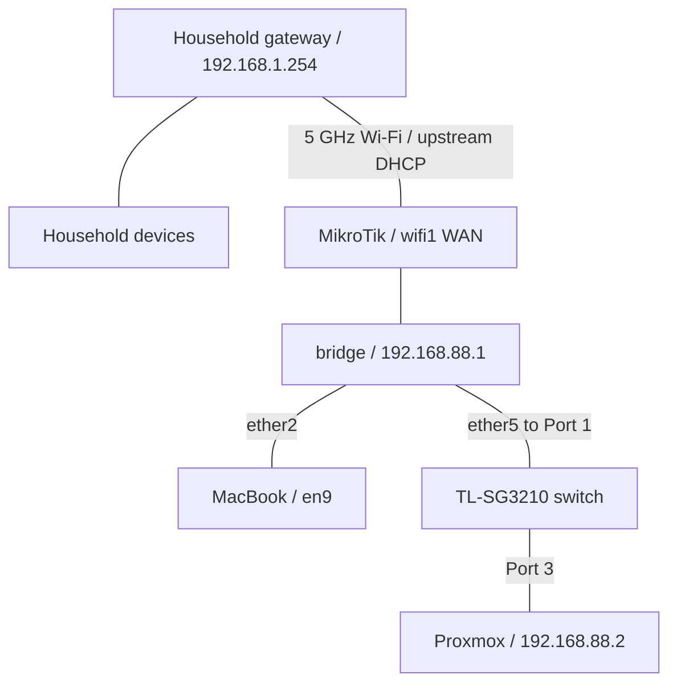

# Phase 5 — Lab Isolation and Firewall Troubleshooting

**Result:** The lab retained a single LAN behind the MikroTik. Two IPv4 forwarding rules and one IPv6 forwarding rule were added. A client test to the household gateway matched the lab-to-household drop rule: **3 packets / 252 bytes**. After an earlier Safe Mode rollback and reapplication, I confirmed that the final changes were saved. Tailscale remote access was postponed to the next session.

> **Historical scope:** Work performed on October 9, 2026, with a friend. This chapter distinguishes applied configuration, observed test results, and proposed work. It does not claim that every isolation direction was tested, that outbound access was limited to update repositories, or that Tailscale was installed.

Previous phase: [Switch Integration and Proxmox Operations](04-switch-and-proxmox-operations.md). Project overview: [README](../README.md).

## 1. Objectives and starting point

The session began with reorganizing the equipment and power connections. The networking goal was to keep the lab simple internally while separating it from household devices:

- Keep lab devices on `192.168.88.0/24`, with individual host addresses and one shared VLAN as the intended switch layout.
- Retain the MikroTik as the gateway, DHCP server, DNS forwarder, and internet boundary.
- Allow clients to initiate internet connections for updates and future VPN connectivity.
- Block direct lab-client access to household addresses and new inbound forwarded connections from WAN.
- Prepare for remote administration through Tailscale later.

Proxmox was already installed and updated in the previous phase. No OS reinstallation, first VM, or new Proxmox configuration was completed in this session.

## 2. Power arrangement and reconnecting equipment

The lab space had no wall outlet. The original arrangement used a separate **15 ft, 16/3 AWG extension cord rated 13 A / 1625 W**, followed by a short **8-outlet strip rated 15 A / 1875 W**. A strip's higher rating does not increase the rating of the cord supplying it.

After comparing alternatives, I reported purchasing a **Commercial Electric strip with an integrated 15 ft cord, 12 outlets, 4500 J surge rating, and 15 A / 125 V / 1875 W rating**. The retailer's specification listed UL certification. This black unit was used as a temporary arrangement while a long white integrated-cord alternative remained under consideration.

The equipment was reported reconnected. No total-load measurement or professional electrical inspection was recorded. Previous use of the earlier arrangement for several days was not itself evidence that equipment had been damaged. These are installation-history notes, not approval of a permanent electrical installation.

## 3. Hardware roles and cable mapping

| Component | Role / observation in this phase |
| --- | --- |
| MikroTik hAP ax³ | Router, DHCP, DNS forwarding, NAT, and firewall; wireless upstream on `wifi1` |
| TP-Link TL-SG3210 JetStream | Switch model explicitly identified during this session; hardware revision and management configuration not verified |
| Intel N100 / Proxmox | Existing server at `192.168.88.2/24` |
| MacBook with USB Ethernet adapter | Router administration and client-side diagnostics |
| Raspberry Pi | Role changed to **client**; OS, address, and successful SSH access not established in the record |

The Pi-as-client decision superseded Phase 4's tentative Pi-for-services plan. A later Tailscale endpoint could still be a suitable Pi or a Linux VM; no host was selected or configured for that role.

| First endpoint | Second endpoint | Purpose |
| --- | --- | --- |
| MikroTik `ether5` | Switch Port `1` | Lab switch uplink |
| Switch Port `3` | N100 Ethernet | Proxmox connection |
| MikroTik `ether2` | MacBook USB Ethernet adapter | Administration |
| MikroTik `wifi1` | Household Wi-Fi | Routed upstream connection |

Switch Port `2` was proposed for the Pi, but its actual connection was not verified. Another computer was reported joining the lab with an address ending in `24`; its full address and reservation status were not confirmed.



This diagram shows connectivity. The household block applies to forwarded client traffic through the MikroTik; it does not stop a computer from using a separate direct household Wi-Fi connection.

## 4. One LAN, bridge membership, and switch routing

The actual RouterOS interface name was **`bridge`**. “Lab bridge” was the descriptive name used in discussion, not a renamed interface.

The bridge joined the MikroTik's lab-facing ports at Layer 2. With the MacBook on `ether2` and the switch on `ether5`, keeping it allowed both connections to remain on the same LAN. It did not create another IP subnet or another NAT boundary. `wifi1`, the WAN station interface, remained outside the bridge.

Removing the bridge would require migrating its IP address, DHCP attachment, interface-list membership, and other references to the replacement interface. That migration was discussed but **not performed**.

The published **TL-SG3210 V3** specifications include static routing / L2+ functionality. The lab unit's hardware revision was not checked, so this phase does not assert that all V3 features are available on it. No switch login, VLAN change, or IP-routing configuration was completed.

Devices in one subnet communicate through switching. Inter-subnet routing practice would need an additional network in a later exercise. Likewise, local traffic between devices in the same VLAN does not necessarily pass through the router's `forward` filter.

## 5. Internet packet path and double NAT

For an N100 client connection to an internet address, the conceptual path was:

1. The client sends an Ethernet frame for its gateway, `192.168.88.1`, through Switch Port `3`, Switch Port `1`, and MikroTik `ether5`.
2. The MikroTik makes a routing decision and applies the forwarding policy.
3. Its WAN masquerade translates the client's source address to the upstream `wifi1` address, observed as `192.168.1.188`.
4. The household gateway, `192.168.1.254`, forwards the packet upstream, with another source-NAT step in the usual household IPv4 arrangement.
5. Replies are associated with the existing connection and translated back toward the client.

The household WAN address, modem arrangement, provider-side CGNAT, and exact external hops were not measured. Double NAT was retained because the existing internet path worked. A routed alternative using a household-router static route was discussed, but household-router support and configuration were not investigated.

**Key distinction:** For an internet connection, the packet's IP destination remains the internet server, even when its next hop is the household gateway. Blocking destinations in `192.168.1.0/24` therefore does not inherently block all internet traffic through `192.168.1.254`.

Double NAT alone is not a lab-to-household access policy. Explicit filtering was still needed.

## 6. Checking the wireless upstream

RouterOS checks included:

```routeros
/interface wifi registration-table print
/ip dhcp-client print detail
```

A mistyped `v/ip dhcp-client` produced a syntax error. Removing the extra `v` fixed the command; no configuration change was involved.

| Observation | Recorded value |
| --- | --- |
| Wireless interface / mode | `wifi1` / `station` |
| Registration | `AUTHORIZED` |
| Signal | `-57 dBm` |
| Band / authentication | `5ghz-ax` / `wpa2-psk` |
| Observed registration uptime | `1h59m11s` |
| Active upstream DHCP client | `wifi1`, `status=bound` |
| Upstream address | `192.168.1.188/24` |
| Gateway / DHCP server / DNS | `192.168.1.254` |
| Default DHCP client on `ether1` | `stopped`, `Interface not active` |

The inactive `ether1` client was not evidence of a failed `wifi1` uplink. It was left unchanged. The station bridge and station pseudobridge alternatives were not selected.

From the **MikroTik console**:

```routeros
/ping 192.168.1.254 count=50 interval=200ms
```

The supplied output contained **9**, not 50, completed requests:

```text
sent=9 received=9 packet-loss=0%
min-rtt=2ms166us avg-rtt=3ms824us max-rtt=4ms914us
```

This was a good short latency sample. No completed 50-request result, throughput test, or long-duration stability measurement was recorded.

## 7. Firewall and network state before changes

| Item | Observed state |
| --- | --- |
| LAN interface list | `bridge` |
| WAN interface list | `ether1`, `wifi1` |
| Bridge IPv4 address | `192.168.88.1/24` |
| Bridge members | `ether2`, `ether3`, `ether4`, `ether5`, `wifi2` |
| Active bridge ports in the supplied output | `ether2`, `ether5` |
| Other listed bridge ports | Inactive at that moment |
| NAT | WAN-list masquerade rule; no `dstnat` rules shown |
| UPnP | `enabled=no` |
| DNS | `allow-remote-requests=yes`; dynamic upstream `192.168.1.254` |
| DHCP server | `defconf`, on `bridge`, pool `default-dhcp`, lease time `30m` |
| DHCP network options | Network `192.168.88.0/24`; gateway and DNS `192.168.88.1` |

The DHCP pool's numeric range was not reprinted in this phase. The previous record contained `192.168.88.10`–`192.168.88.254`.

The existing IPv4 **input** policy accepted established/related/untracked traffic, dropped invalid traffic, allowed ICMP and the CAPsMAN loopback exception, and dropped other input not arriving from LAN. This already restricted ordinary management connections arriving from the household side; it was not a blanket ICMP block.

The existing IPv4 **forward** policy had IPsec exceptions, FastTrack, established/related/untracked acceptance, invalid-packet dropping, and a rule dropping new WAN connections that were not destination-NATed. It had **no explicit lab-client block to `192.168.1.0/24`**. The Raw table contained a dynamic FastTrack accounting dummy rather than an added isolation rule.

IPv6 was enabled with forwarding allowed. Loopback and link-local addresses were shown; no global IPv6 address was shown. A separate IPv6 policy existed, including `defconf: fasttrack6`. IPv6 was not disabled globally.

## 8. Policy selected and access to the console

The original request to “block outside access” was clarified: clients still needed to initiate updates and future Tailscale connections. The implemented scope was:

| Traffic | Selected behavior |
| --- | --- |
| Lab clients to the public internet | Retain existing outbound access |
| Replies to allowed connections | Retain connection-tracking-based acceptance |
| Lab clients to household subnet | Drop forwarded traffic to `192.168.1.0/24` |
| New forwarded connections entering WAN | Drop, including connections that a future port-forward rule might otherwise permit |
| Routed IPv6 | Drop pending deliberate IPv6 configuration |
| Tailscale | Future endpoint inside the lab; not deployed in this phase |

**This was not an outbound repository or service allowlist.** No domain-restricted update policy was implemented.

Clients used `192.168.88.1` for DNS. The router could continue querying its upstream DNS server because router-originated traffic is not client traffic in the `forward` chain. A lab client configured to query `192.168.1.254` directly would be affected by the household block.

Because pasting into the web terminal was difficult, SSH from the **MacBook Terminal** was explained:

```bash
ssh admin@192.168.88.1
```

The password is the router administration password. `Command + C` / `Command + V` copy and paste on macOS. RouterOS commands can be separated by semicolons; console prompts such as `[admin@MikroTik]` and `<SAFE>` are not part of the command.

An export named `before-lab-isolation` was proposed before changes, but its creation and download were not confirmed. Safe Mode was entered using **Control + X**, and the `<SAFE>` prompt was observed.

## 9. Rules applied

The following is a historical record of the applied changes, **not an idempotent installation script**. Running these `add` commands again would create duplicates. The `place-before` expressions depend on the exact existing comments that were present in this router's configuration.

### IPv4 forwarding rules

Both were inserted before `defconf: accept in ipsec policy`, ahead of the IPsec exceptions, FastTrack, and established-connection acceptance:

```routeros
/ip firewall filter add chain=forward action=drop in-interface-list=LAN dst-address=192.168.1.0/24 comment="LAB: block access to home subnet" place-before=[find where comment="defconf: accept in ipsec policy"]
/ip firewall filter add chain=forward action=drop in-interface-list=WAN connection-state=new comment="LAB: block new inbound WAN connections" place-before=[find where comment="defconf: accept in ipsec policy"]
```

### IPv6 forwarding rule

Inserted before `defconf: fasttrack6`:

```routeros
/ipv6 firewall filter add chain=forward action=drop comment="LAB: block routed IPv6 pending configuration" place-before=[find where comment="defconf: fasttrack6"]
```

This blocks routed IPv6. It does not disable IPv6 on clients or replace the router's IPv6 `input` rules.

### Removing existing tracked lab-to-household connections

```routeros
/ip firewall connection remove [find where src-address~"^192[.]168[.]88[.]" dst-address~"^192[.]168[.]1[.]"]
```

This removed matching connection-tracking entries so that existing sessions, including ones previously FastTracked, would not continue under their earlier state. It did not remove routes, change the default gateway, or create a permanent firewall rule. A connection to a public server does not match the household destination expression just because it uses the household router as its next hop.

## 10. Cable disconnection and Safe Mode rollback

The cable was accidentally unplugged and the console session ended. After logging back in, the `<SAFE>` tag was absent. Rather than assuming that the tag's absence meant the rules were saved, the configuration was checked:

```routeros
/ip firewall filter print detail without-paging where comment~"LAB:"
/ipv6 firewall filter print detail without-paging where comment~"LAB:"
/system history print detail without-paging
```

**Observed evidence:**

- Neither filter search returned a `LAB:` rule.
- System history showed the three additions with the **`R` — redoable** flag.

Together these showed that the changes had been rolled back. Safe Mode was entered again, the missing rules were reapplied, and the targeted connection removal was repeated. A blind addition on top of existing copies was not used.

A failed SSH login for `admin` from `192.168.88.251` also appeared in the log. That address was later identified as the MacBook's lab address. The entry was not evidence of a successful unauthorized login; its exact cause was not independently established.

At the end of the session, **I explicitly confirmed that the Safe Mode step was complete and the final changes were saved**. An `after-lab-isolation` export was suggested; its creation and download were not confirmed.

## 11. Initial tests and the zero-counter discrepancy

From the **MacBook's local Terminal**:

```bash
ping -c 3 192.168.88.1
ping -c 3 192.168.1.254
curl -I --connect-timeout 10 https://example.com
```

| Test | Recorded result |
| --- | --- |
| Lab gateway ping | Eventually 3/3 replies; one later sample averaged `1.618 ms` |
| Household gateway ping | Timeouts |
| Public HTTPS request | `HTTP/2 200` in repeated tests |
| Household drop-rule counter initially | `0 bytes / 0 packets` |
| New-WAN drop-rule counter | `0 bytes / 0 packets` |

An earlier lab-gateway attempt had returned `No route to host`, then a repeat succeeded. The transient cause was not proven.

The combination of household ping timeouts and a **zero** household-drop counter meant that a timeout alone could not validate the firewall. The next step was to inspect which path the MacBook was actually using.

## 12. Discovering two network paths on the MacBook

Diagnostic commands in the **local macOS Terminal**:

```bash
networksetup -listallhardwareports
scutil --nwi
route -n get 192.168.1.254
route -n get default
netstat -rn -f inet
```

| Interface | Hardware port | Observed address |
| --- | --- | --- |
| `en9` | USB 10/100/1000 LAN | `192.168.88.251` |
| `en0` | Wi-Fi | `192.168.1.187` |

The route to `192.168.1.254` selected **`en0`**, with direct-link flags including `HOST` and `LLINFO`. It did not traverse the lab gateway. The routing table later showed:

| Destination | Gateway / link | Interface |
| --- | --- | --- |
| Primary default | `192.168.88.1` | `en9` |
| Additional scoped default | `192.168.1.254` | `en0` |
| `192.168.1.0/24` | `link#6` | `en0` |
| `192.168.88.0/24` | `link#13` | `en9` |
| Household gateway host entry | Direct local-link entry | `en0` |

A more specific connected route wins over the default route. Public internet access could therefore use the lab default while the household ping attempted the separate Wi-Fi path. The MikroTik cannot filter traffic that does not pass through it.

The Wi-Fi GUI was shown **Off** in a screenshot, yet the supplied network-state and routing output still contained the household Wi-Fi address and routes. This did not establish that the radio was transmitting. The working explanation was retained service configuration or routing state; the exact macOS mechanism was not proven.

No custom static route, subnet-mask workaround, or blanket route-table flush was introduced. The goal remained to make the router enforce the policy, while ensuring the test client actually used that router.

## 13. Disabling the Wi-Fi service and verifying the drop

The proposed correction was to disable the **Wi-Fi network service** temporarily while leaving the lab Ethernet connection in place:

```bash
sudo networksetup -setnetworkserviceenabled "Wi-Fi" off
```

This is a service-level setting, distinct from the Wi-Fi radio button. It does not create a custom route or forget saved Wi-Fi passwords.

Following this step and a further test, RouterOS counters were printed:

```routeros
/ip firewall filter print stats without-paging where comment~"LAB:"
```

```text
CHAIN    ACTION    BYTES    PACKETS
;;; LAB: block access to home subnet
forward  drop       252          3
;;; LAB: block new inbound WAN connections
forward  drop         0          0
```

**This was the decisive evidence:** three test packets reached and matched the household-destination drop rule. The earlier zero counter had been a test-path problem, not proof that the rule was ineffective.

The record did not include another final route printout or a separate `curl` result after disabling the service. Earlier HTTPS successes are retained as earlier observations rather than presented as an additional unrecorded final test. The zero inbound-WAN counter was not a failed test; no deliberate inbound test was performed.

The command to restore the network service was explained:

```bash
sudo networksetup -setnetworkserviceenabled "Wi-Fi" on
```

Its execution at the end was not confirmed. The GUI radio control and the service setting are not competing rules with a single priority. Normal Wi-Fi connectivity requires the relevant service and radio to be available. Rejoining household Wi-Fi would give the MacBook a direct household path again without deleting any MikroTik firewall rule.

## 14. End-of-phase state and verification limits

| Area | End-of-session state |
| --- | --- |
| Internal lab network | One existing `192.168.88.0/24` LAN; bridge retained |
| Upstream | `wifi1` station; DHCP lease observed as `192.168.1.188/24` |
| Lab-to-household IPv4 | Rule applied; gateway-target test matched 3 packets / 252 bytes |
| New forwarded WAN connections | Drop rule applied; no deliberate inbound test recorded |
| Routed IPv6 | Drop rule applied before FastTrack6; no routed IPv6 test recorded |
| Outbound internet | Existing general egress retained; HTTPS success observed during the session |
| Persistence | Final Safe Mode commit confirmed by the user |
| Configuration exports | Suggested; creation and download unconfirmed |
| Switch | Model identified as TL-SG3210; revision, management, VLAN, and routing work pending |
| Pi | Intended client role; OS, address, and SSH verification pending |
| Tailscale | Not installed or tested |

The forwarding policy does not isolate lab devices from one another, control an independent client Wi-Fi path, or limit egress to update repositories. The existing router-input policy was retained. Router-originated communication with the household gateway continued to be part of the working design.

## 15. Next session: remote access

The session ended before deploying Tailscale. The proposed next sequence was:

1. Choose a suitable always-on endpoint inside the lab: a Pi with a ready operating system or a Linux VM on Proxmox.
2. Verify its OS, architecture, lab address, and ordinary connectivity.
3. Install and authenticate Tailscale, then advertise `192.168.88.0/24` if subnet routing is needed.
4. Configure route approval and access permissions for the intended users/devices.
5. Test from an external connection, such as a phone hotspot, without the lab Ethernet connection.
6. Resume switch management, shared-VLAN documentation, and planned routing exercises after remote access works.

No public management port forward was opened, and installing Tailscale on the MikroTik itself was not the selected implementation. A particular direct or relayed Tailscale path was not tested.

## 16. Lessons learned

- A separate subnet and double NAT do not by themselves block access to household devices.
- `input`, `forward`, and router-originated traffic have different firewall paths.
- An IP destination is different from the next-hop router that carries the packet.
- A bridge can still be useful when an external switch is present, especially when clients use multiple router LAN ports.
- Rule order and already tracked/FastTracked sessions matter when introducing a new restriction.
- Losing a Safe Mode session can roll changes back; check rule presence and history rather than relying on the prompt alone.
- A ping timeout does not prove that the intended firewall dropped the request.
- A more specific client route can bypass the gateway under test even when the default route is correct.
- Correlating a controlled test with a firewall counter provides stronger evidence than connectivity symptoms alone.
- Record saved configuration separately from tests that remain pending.

## Quick reference

| Item | Phase 5 value |
| --- | --- |
| Lab subnet / gateway / DNS | `192.168.88.0/24` / `192.168.88.1` / `192.168.88.1` |
| Proxmox address / URL | `192.168.88.2/24` / `https://192.168.88.2:8006` |
| Household subnet / gateway | `192.168.1.0/24` / `192.168.1.254` |
| MikroTik upstream DHCP snapshot | `wifi1` / `192.168.1.188/24` |
| Router LAN / WAN interface lists | `bridge` / `ether1, wifi1` |
| Bridge members | `ether2, ether3, ether4, ether5, wifi2` |
| MacBook Ethernet snapshot | `en9` / `192.168.88.251` |
| MacBook household Wi-Fi snapshot | `en0` / `192.168.1.187` |
| Lab DHCP | `defconf`; `interface=bridge`; `lease-time=30m`; `address-pool=default-dhcp` |
| IPv4 rule insertion anchor | `defconf: accept in ipsec policy` |
| IPv6 rule insertion anchor | `defconf: fasttrack6` |
| Verified household-drop counter | `252 bytes / 3 packets` |
| Safe Mode shortcut | `Control + X` to enter/release; `Control + D` in Safe Mode to undo and exit |
| Remote access | Tailscale pending |

DHCP addresses are dated observations and may change. The earlier numeric DHCP pool range remains historical rather than freshly verified in this phase.

### Read-only checks — MikroTik console

```routeros
/interface wifi registration-table print detail
/ip dhcp-client print detail
/ip dhcp-server network print detail without-paging
/ip dhcp-server print detail without-paging
/ip firewall filter print detail without-paging where comment~"LAB:"
/ip firewall filter print stats without-paging where comment~"LAB:"
/ipv6 firewall filter print stats without-paging where comment~"LAB:"
/system history print detail without-paging
```

### Connectivity checks — local MacBook Terminal

Run these locally on macOS, not inside an SSH session to RouterOS:

```bash
networksetup -listallhardwareports
scutil --nwi
route -n get default
route -n get 192.168.1.254
netstat -rn -f inet
ping -c 3 192.168.88.1
ping -c 3 192.168.1.254
curl -I --connect-timeout 10 https://example.com
```

For an isolation test, first verify that the destination route uses the lab gateway and Ethernet interface, then compare the relevant RouterOS counter before and after the client request. A ping originated by the router itself does not test the client's `forward` rule.

## References

- [MikroTik — Packet flow in RouterOS](https://manual.mikrotik.com/docs/firewall-and-quality-of-service/packet-flow-in-routeros/)
- [MikroTik — Connection tracking](https://manual.mikrotik.com/docs/firewall-and-quality-of-service/connection-tracking/)
- [MikroTik — Configuration management and Safe Mode](https://manual.mikrotik.com/docs/getting-started/configuration-management/)
- [TP-Link — TL-SG3210 V3 specifications](https://www.tp-link.com/us/business-networking/omada-sdn-switch/tl-sg3210/v3/)
- [Tailscale — Firewall ports](https://tailscale.com/docs/reference/faq/firewall-ports)

*Source: Hebrew lab isolation report and recorded RouterOS/macOS outputs from October 9, 2026. Credentials, household SSIDs, MAC addresses, and personal computer/account names are omitted. Private addresses needed to understand the routing and rules are retained.*
